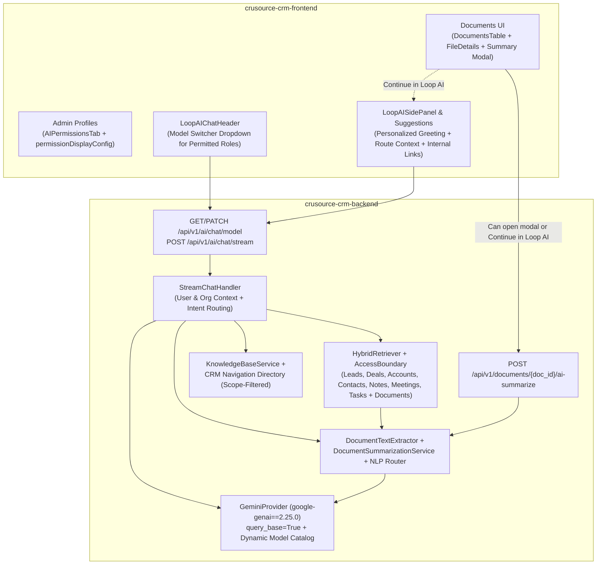

# Loop AI Documents RAG, Document AI Summarize, Companion Persona & Gemini Model Switching — Implementation Plan

- **Status:** `PLANNED / DOCUMENTED ONLY` (not yet implemented)
- **Date:** November 18, 2026
- **Scope Repositories:**
  - `../crusource-crm-backend` (FastAPI, SQLAlchemy, Alembic, `google-genai`)
  - `../crusource-crm-frontend` (Next.js App Router, React, Tailwind, Redux Toolkit, TanStack Query, `next-intl`)
- **Related Docs:**
  - [AI_FEATURES_FRD_AND_VALUE_ANALYSIS.md](AI_FEATURES_FRD_AND_VALUE_ANALYSIS.md)
  - [AI_Plan.md](AI_Plan.md)

---

## 1. Executive Summary & Current-State Audit

This plan covers five connected improvements requested for **Loop AI** and the **Documents** module in Crusource CRM:

1. **Documents in Loop AI Hybrid RAG:** Index and retrieve uploaded CRM documents (`Document`) safely inside Loop AI's Hybrid RAG pipeline while strictly respecting polymorphic parent access boundaries.
2. **Documents "AI Summarize" Feature + Profiles & Permissions + Loop AI Integration:** Add a dedicated `AI Summarize` button in the Documents UI, govern it with a new `ai_document_summarize` setup permission in Profiles & Permissions, and expose the same capability inside Loop AI natural language chat.
3. **Companion Personality & User/Account Personalization:** Inject current user identity (`first_name`, `name`, `role`, `territory`, `preferred_language`) and workspace/organization context (`Organization.name`, `OrgSettings.company_name`, `industry`, `default_currency`) into Loop AI prompts and conversational replies so Loop AI speaks like an assistive CRM companion rather than a robotic database responder.
4. **CRM Navigation & Usage Guidance:** Expand Loop AI's knowledge directory beyond `/docs/{slug}` guides so it can guide users directly to permission-checked in-app CRM routes (e.g., `/dashboard/documents`, `/dashboard/reports`, `/dashboard/admin/profiles`).
5. **Gemini SDK & Model-Switching Audit + Fix Plan:** Explain why users are currently stuck on `gemini-2.5-flash` despite using a modern SDK, and enable safe, org-governed model switching in the CRM.

### 1.1 Findings from Codebase Inspection

| Area | Current Behavior & Root Cause | Key Source References |
| --- | --- | --- |
| **Documents in Hybrid RAG** | **Not integrated.** `SOURCES` (`embedding_source_repository.py`), `LIVE_SOURCES` (`live_record_repository.py`), `RECORDS` (`record_registry.py`), `access_boundary.py` (`embedding_query`, `current_chunks`), `history_access.py`, and `ENTITY_KEYWORD_MAP` (`intent_classifier.py`) exclude `document`. Furthermore, `Document` (`src/modules/documents/repositories/models.py`) stores only metadata and binary storage pointer (`file_path` via `DocumentStorageService`), not extracted plain text. | `src/modules/ai_chat/repositories/embedding_source_repository.py`, `src/modules/ai_chat/repositories/live_record_repository.py`, `src/modules/ai_chat/services/retrieval/access_boundary.py`, `src/modules/documents/repositories/models.py` |
| **Documents AI Summarize** | **Missing.** `FileDetails.tsx` and `DocumentsTable.tsx` offer View/Edit, Share, Copy Link, Assign, and Download; `AI_CAPABILITY_AREAS` (`profile_seed_service.py`) and `AI_SETUP_KEYS` (`permissionDisplayConfig.ts`) currently contain 6 keys (`ai_lead_scoring`, `ai_campaign_draft`, `ai_email_draft`, `ai_column_mapping`, `loop_ai_chat`, `loop_ai_reports`) and no document summarization key. | `src/modules/profiles/services/profile_seed_service.py`, `src/lib/profiles/permissionDisplayConfig.ts`, `src/components/documents/FileDetails.tsx`, `src/components/documents/DocumentsTable.tsx` |
| **Persona & Context** | **Robotic & generic.** `StreamChatHandler` passes `scope.org_id` and `query` into `RetrieveCRMContextHandler` and `GeminiProvider.stream_chat_response`, without loading the user's `User` record or `Organization`/`OrgSettings` profile. `conversational_replies.py` returns hardcoded static greeting/capability strings, and `WORKSPACE_SYSTEM_PROMPT` reads like a schema manual. | `src/modules/ai_chat/handlers/stream_chat_handler.py`, `src/modules/ai_chat/services/conversational_replies.py`, `src/modules/ai_chat/services/providers/gemini_provider.py` |
| **Navigation Help** | **Partial.** `KnowledgeBaseService` (`kb_service.py`) + `kb_catalog.json` only trigger on `is_how_to` or high KB keyword scores (`>= 8.0`) and only emit `/docs/{slug}` documentation URLs rather than role-aware in-app CRM navigation links (`/dashboard/...`). | `src/modules/ai_chat/services/knowledge/kb_service.py`, `src/modules/ai_chat/services/knowledge/kb_catalog.json`, `src/modules/ai_chat/services/hybrid_retriever.py` |
| **Gemini SDK Version** | **Modern SDK already installed.** `crusource-crm-backend/requirements.txt` specifies `google-genai>=2.25.0` and `requirements-runtime.lock` pins `google-genai==2.25.0` (using `from google import genai` and `client.aio.models.generate_content_stream`). It is **not** using the deprecated `google-generativeai` library. | `requirements.txt`, `requirements-runtime.lock`, `src/modules/ai_chat/services/providers/gemini_provider.py` |
| **Why Stuck on `gemini-2.5-flash`** | 1. Model switching API (`GET/POST /api/v1/superadmin/organizations/{org_id}/loop-ai-model`) is restricted strictly to `require_super_admin` in `superadmin/routes/organization_routes.py`; CRM org admins and users have no endpoint under `/api/v1/org-settings` or `/api/v1/ai/chat/model`.<br>2. `GET /api/v1/ai/chat/model` returns only `{ "model": "..." }`, and `LoopAIChatHeader.tsx` renders a static read-only `<span>` badge.<br>3. `GeminiProvider.list_chat_models()` calls `client.models.list(config={"page_size": 100, "query_base": False})` (`gemini_provider.py:79`), where `query_base=False` queries non-base/tuned models rather than Gemini's base catalog models—starving or breaking model discovery.<br>4. `stream_public_chat_response` (`gemini_provider.py:399`) hardcodes `os.getenv("PUBLIC_AI_MODEL", "gemini-2.5-flash")`, and `generate_structured_with_usage` (`gemini_provider.py:434`) special-cases `"2.5" in str(self.chat_model).lower()` for `ThinkingConfig`. | `src/modules/superadmin/routes/organization_routes.py`, `src/modules/ai_chat/routes/ai_routes.py`, `src/modules/ai_chat/services/providers/gemini_provider.py`, `src/components/ai/LoopAIChatHeader.tsx`, `src/hooks/ai/useLoopAIModel.ts` |

---

## 2. Target Architecture Overview



---

## 3. Phase 1: Gemini SDK & Model-Switching Enablement

Fixing model discovery and tenant/user switching first ensures that both Loop AI Chat and the new Document Summarizer run on the selected model seamlessly.

### 3.1 Root Cause Verification & Provider Fixes (`crusource-crm-backend`)

- **SDK Status:** Retain `google-genai>=2.25.0` (`google-genai==2.25.0` in `requirements-runtime.lock`). No package migration from `google-generativeai` is needed.
- **Fix `GeminiProvider.list_chat_models()` (`src/modules/ai_chat/services/providers/gemini_provider.py`):**
  - Replace `config={"page_size": 100, "query_base": False}` with base-model listing (`query_base=True` / `types.ListModelsConfig(page_size=100, query_base=True)`).
  - Filter to interactive text-generation Gemini models (`"generateContent"` in `supported_actions`, excluding embedding/imagen/veo/aqa/tts/robotics-only IDs), and return curated metadata (`id`, `display_name`, `tier`: `flash` | `pro` | `lite`, `description`) sorted by recommended priority.
  - Cache the discovered model catalog in Redis / short TTL memory cache (e.g., 10 minutes, keyed by API key hash) so `/api/v1/ai/chat/model` does not incur a Google `models.list` round-trip on every header mount, while invalidating on error.
- **Normalize Model-Specific Thinking & Structured Config (`gemini_provider.py`):**
  - Inspect model family (`gemini-2.5-*`, `gemini-3*`, `gemini-*-flash*`, `gemini-*-pro*`) cleanly when applying `types.ThinkingConfig` in `generate_structured_with_usage`:
    - Keep `thinking_budget=0` for `gemini-2.5-flash` / `gemini-2.5-flash-lite` structured JSON extraction where supported.
    - Guard optional parameters per model capability (avoid breaking models that require minimal thinking budget or ignore `thinking_budget=0` vs `thinking_level`).
  - Handle runtime fallback/clear error surfacing when a configured model becomes deprecated or rate-limited.

### 3.2 Tenant Governance & User Preference Design

Instead of locking model selection inside `src/modules/superadmin/routes/organization_routes.py`, adopt a two-level model policy:

1. **Organization Default Model (`OrgSettings.loop_ai_model` + optional `OrgSettings.ai_allowed_models` JSONB/array or boolean `allow_user_model_switch`):**
   - Managed by tenant admins holding `require_any_setup_permission("org_settings", "customization")` (or `ai_management` if introduced; using `org_settings` fits existing `organization_routes.py:31` and `org_settings_routes.py:29` immediately).
2. **Optional Per-User Loop AI Model Preference:**
   - Store optional `preferred_loop_ai_model` inside `User.dashboard_preferences` (JSONB column already present in `src/modules/user/repositories/models.py:73`) OR a nullable `users.preferred_loop_ai_model` column via Alembic migration.
   - Precedence at inference time (`StreamChatHandler`, `DraftEmailHandler`, `ai_routes.py`, `DocumentSummarizationService`):
     1. Validated request override (only if within org/key allowed list), else
     2. User preference (if allowed by org policy and still valid in `list_chat_models()`), else
     3. `OrgSettings.loop_ai_model`, else
     4. `os.getenv("LOOP_AI_MODEL", "gemini-2.5-flash")`.

### 3.3 Backend & Frontend API Changes

- **Backend Routes (`src/modules/ai_chat/routes/ai_routes.py` & `src/modules/org_settings/routes/org_settings_routes.py`):**
  - Expand `GET /api/v1/ai/chat/model` response (`ChatModelResponse`):
    ```json
    {
      "model": "gemini-2.5-flash",
      "org_default_model": "gemini-2.5-flash",
      "available_models": [
        { "id": "gemini-2.5-flash", "label": "Gemini 2.5 Flash", "tier": "fast" },
        { "id": "gemini-2.5-pro", "label": "Gemini 2.5 Pro", "tier": "reasoning" }
      ],
      "can_switch_org_default": true,
      "can_switch_personal": true
    }
    ```
  - Add `PATCH /api/v1/ai/chat/model`: validates payload against `GeminiProvider().list_chat_models()`. Updates `User.dashboard_preferences["loop_ai_model"]` for personal preference (when enabled for the user) or updates `OrgSettings.loop_ai_model` when `scope == "organization"` and caller passes `require_setup_permission("org_settings")`.
  - Add `GET / PATCH /api/v1/org-settings/ai-model` (and extend `OrgSettingsResponse` / `OrgSettingsUpdate` in `src/modules/org_settings/queries/org_settings_queries.py` and `commands/org_settings_commands.py`) for tenant admins without needing legacy superadmin.
  - Keep `src/modules/superadmin/routes/organization_routes.py` endpoints backward-compatible.
- **Frontend UI (`crusource-crm-frontend`):**
  - Update `aiChatService.ts` (`getLoopAIModel`, `updateLoopAIModel`) and `useLoopAIModel.ts` + a new `useUpdateLoopAIModelMutation`.
  - Upgrade `LoopAIChatHeader.tsx` lines 85–93 from a static `<span>` pill into an accessible dropdown menu (showing checkmarks and tier hints like `Fast` / `Pro Reasoning`) whenever `available_models.length > 1` and switching is allowed; fall back to the static pill for read-only profiles.
  - Add an **AI Model Settings** card in Admin Hub / Organization Settings (`/dashboard/admin` or `/dashboard/settings`) so admins can set the workspace default model.

---

## 4. Phase 2: Documents Integration in Loop AI Hybrid RAG

### 4.1 Security & Access Boundary Rules (Critical)

Documents in Crusource CRM are governed by `src/modules/documents/services/document_parent_access.py`:
- Every `Document` belongs to `org_id`, uses `LinkedRecordTeamMixin` (`record_team_id`), supports soft delete (`deleted_at` / recycle bin), and may link to up to 7 parent types (`deal_id`, `lead_id`, `account_id`, `contact_id`, `meeting_id`, `task_id`, `call_id`).
- `require_document_parents(db, scope, document)` checks:
  1. `document.org_id == scope.org_id`
  2. Module permission (`documents` view via `apply_scope`)
  3. Every attached parent passes `validate_and_resolve_parent(..., scope, require_edit=False)` and `parent.record_team_id == document.record_team_id`.

**Rule:** Loop AI MUST enforce the exact same boundary at **every** stage (SQL candidate pre-filter, `current_chunks`, live fallback, summarization, and history reload).

### 4.2 Document Text Extraction Pipeline

- **Supported Formats (using declared `requirements.txt` packages):**
  - **PDF (`.pdf`):** Extract text via `pypdfium2==5.14.0` (already in `requirements.txt:35`) page-by-page up to a safe character ceiling (e.g., 40,000 chars / 40 pages per document to protect memory and LLM context budgets). Detect scanned/image-only PDFs gracefully and record metadata fallback (`"No selectable text layer detected; filename & category indexed"`).
  - **Word (`.docx`):** Extract paragraphs and tables via `python-docx==1.2.0` (already in `requirements.txt:36`).
  - **Spreadsheets (`.xlsx`, `.xlsm`):** Summarize sheet names, header rows, and top sample rows via `openpyxl==3.1.5` (already in `requirements.txt:31`).
  - **Plain Text / Structured Text (`.txt`, `.md`, `.csv`, `.json`, `.html`):** UTF-8 decode with fallback encodings and HTML tag stripping (`lxml==6.1.3`).
- **New Extraction Service (`src/modules/documents/services/document_text_extractor.py`):**
  - Reads bytes via existing `document_storage_service.read_bytes(doc.file_path)` (S3 or `local:` backend).
  - Normalizes whitespace, strips null bytes, enforces max extraction timeout / byte cap (matching `UPLOAD_POLICY`), and computes `content_sha256`.
- **Persistence Strategy (Alembic Migration):**
  - Add nullable text/cache columns on `documents` table (or dedicated `document_ai_contents` table keyed by `doc_id` to keep `documents` row reads lightweight):
    - `extracted_text` (`Text`, bounded or truncated normalized text for lexical + RAG serialization)
    - `extracted_text_hash` (`String(64)`)
    - `extracted_at` (`DateTime(timezone=True)`)
    - `ai_summary` (`JSONB` or `Text` cache for Phase 3 "AI Summarize")
    - `ai_summary_hash` (`String(64)`)
    - `ai_summary_model` (`String(80)`)
    - `ai_summary_updated_at` (`DateTime(timezone=True)`)
  - **Hook Extraction on Lifecycle Events:**
    - On upload (`upload_document_handler.py`, `upload_batch_handler.py`), version restore/upload (`version_handlers.py`), or inline editor save (`update_binary_content_handler.py`): extract text (inline if small/fast, or background task with non-blocking fallback) and call `EmbeddingService.sync_single_record(db, org_id, "document", doc)`.
    - On manual **Sync Knowledge Base** (`POST /api/v1/ai/sync-embeddings` -> `SyncEmbeddingsHandler`): backfill missing `extracted_text` for existing documents before computing embeddings.

### 4.3 Hybrid RAG & History Integration

1. **Serializer (`src/modules/ai_chat/services/record_serializers.py` & `embedding_service.py`):**
   - Add `RecordSerializers.serialize_document(doc: Document) -> Tuple[str, str]` and alias `EmbeddingService.serialize_document`.
   - Include: `Title: Document: {file_name}`, `Category: {document_category}`, `File Type: {file_type}`, linked parent names (`deal`, `account`, `contact`, `lead`, `meeting`, `task`, `call`), `Uploaded By`, and extracted text excerpt (up to chunk budget, or multi-chunk indexing `document` / `document_chunk` mapped to `entity_id = doc.id` with bounded top chunk selection).
2. **Embedding Sources & Live Fallback:**
   - `embedding_source_repository.py`: add `EmbeddingSource("document", "documents", Document, "updated_at", 300, True)` to `SOURCES` (filtering `Document.deleted_at.is_(None)`).
   - `live_record_repository.py`: add `("document", Document, (Document.file_name, Document.file_type, Document.extracted_text))` to `LIVE_SOURCES`, enforcing `Document.deleted_at.is_(None)` and `scope.can_view_module("documents")`.
3. **Strict Access Boundaries (`access_boundary.py` & `history_access.py`):**
   - In `embedding_query(db, org_id)`: when `scope.can_view_module("documents")` and `"hidden" not in field_access(db, scope, "documents").values()`, filter candidate `Document.id` via `apply_scope(..., Document, scope)` + `Document.deleted_at.is_(None)` (note: parent checks still run on matched candidates in `current_chunks` and live results so unauthorized linked documents never leak).
   - In `current_chunks(db, embeddings)`: add explicit `document` branch that queries `Document` with `apply_scope(..., Document, scope)`, checks `Document.deleted_at.is_(None)`, validates via `require_document_parents(db, scope, record)` (skipping on `403`/`404`), and rehydrates live metadata + extracted text via `serialize_document`.
   - In `history_access.py`:
     - Include `"documents"` in `authorization_revision` field access snapshot.
     - Add `entity_type == "document"` branch in `history_is_visible`: enforce `scope.can_view_module("documents")`, `apply_scope`, `deleted_at.is_(None)`, and `require_document_parents(db, scope, doc)`.
4. **Intent Classification & Citations:**
   - Update `ENTITY_KEYWORD_MAP` in `intent_classifier.py` with `"document": ["document", "documents", "file", "files", "pdf", "docx", "attachment", "attachments", "proposal", "msa", "nda", "sow", "kyc", "contract", "contracts", "agreement", "brief"]`.
   - Update `HybridRetriever` (`hybrid_retriever.py` line 58) field restriction check to include `"documents"` where appropriate, and optionally include document count in `CRMAnalyticsService` overview (excluding `deleted_at IS NOT NULL`).
   - Update `LoopAISourceDrawer.tsx` (`crusource-crm-frontend`) so citations with `entity_type === "document"` navigate cleanly to `/dashboard/documents?id=${entity_id}`.

---

## 5. Phase 3: Documents "AI Summarize" Feature, Permissions & Loop AI Execution

### 5.1 Profiles & Permissions (`ai_document_summarize`)

Mirror the exact pattern used by `ai_lead_scoring` and `ai_email_draft`:

- **Backend (`src/modules/profiles/services/profile_seed_service.py`):**
  - Add `"ai_document_summarize"` to `AI_CAPABILITY_AREAS` (lines 122–129), which automatically registers it in `SETUP_AREAS`.
  - Profile defaults in `_get_setup_permissions_for_profile`:
    - `Administrator`: `True`
    - `Manager`: `True`
    - `Standard`: `True` (or `False` if restricted by tenant preference; recommended `True` alongside `ai_lead_scoring` and `ai_email_draft` unless admin toggles it off — document decision clearly before coding).
  - Existing organization profiles backfill cleanly via existing `sync_ai_capabilities` logic (`lines 633–662`), plus an Alembic data migration / seed helper so upgraded tenants see the toggle in **Admin Hub → Profiles → AI Capabilities** immediately without re-seeding.
- **Frontend (`crusource-crm-frontend`):**
  - `src/lib/profiles/permissionDisplayConfig.ts`:
    - Add `ai_document_summarize` entry to `SETUP_PERMISSION_METADATA` (`FileText` / `Sparkles` icon).
    - Add `"ai_document_summarize"` to `AI_SETUP_KEYS` (lines 428–435) and `AI_CAPABILITY_CONFIG` (lines 439–504, category `"Document Intelligence"`, badge `"Documents"`). `AIPermissionsTab.tsx` renders it automatically from `AI_SETUP_KEYS`.
  - Add i18n strings in `src/messages/en/adminProfiles.json`, `src/messages/nl/adminProfiles.json`, and `src/messages/ar/adminProfiles.json`.
  - Update `tests/test_ai_permissions_components.tsx` to assert `AI_SETUP_KEYS.includes("ai_document_summarize")`.

### 5.2 Backend Document Summarization Service & API

- **Core Service (`src/modules/documents/services/document_summarization_service.py`):**
  - Input: `db`, `scope`, `document`, `focus: Optional[str] = None` (e.g., `"executive"`, `"risks"`, `"action_items"`, `"custom question"`), `force_refresh: bool = False`.
  - Enforces:
    1. `require_document_parents(db, scope, document)` + `deleted_at is None`
    2. Extracts text via `document_text_extractor.py` (uses cached `extracted_text` if hash matches)
    3. Checks cached `ai_summary` when `!focus && !force_refresh` and `ai_summary_hash == extracted_text_hash`
    4. Resolves org/user active Gemini model via shared model-resolution helper and calls `GeminiProvider.generate_structured_with_usage(...)` with strict JSON schema:
       - `executive_summary` (2–4 sentences)
       - `key_points` (bulleted takeaways)
       - `risks_or_clauses` (for MSAs/NDAs/proposals/SOWs)
       - `recommended_next_steps` (actionable CRM follow-ups)
       - `document_type_detected`
    5. Persists cache (`ai_summary`, `ai_summary_hash`, `ai_summary_model`, `ai_summary_updated_at`) when default summary runs; logs/tracks token usage safely without failing on optional telemetry.
    6. Graceful fallback when Gemini key is unavailable or document has no selectable text (returns clear diagnostic message instead of crashing).
- **Endpoint (`src/modules/documents/routes/documents_routes.py` + CQRS Handler `ai_summarize_document_handler.py`):**
  - `POST /api/v1/documents/{doc_id}/ai-summarize`
  - Dependencies:
    - `Depends(require_permission("documents", "view"))`
    - `Depends(require_setup_permission("ai_document_summarize"))`
    - `Depends(require_active_subscription)`
  - Accepts optional `{ "focus": string | null, "force_refresh": bool }`.

### 5.3 Loop AI Conversational Access (`document_summary_nlp_service.py`)

Follow the exact architecture of `lead_scoring_nlp_service.py` + `stream_chat_handler.py`:

- Create `src/modules/ai_chat/services/document_summary_nlp_service.py`:
  - `is_document_summary_intent(prompt: str) -> bool`: detects intents such as `"summarize proposal.pdf"`, `"give me a summary of the MSA document"`, `"key takeaways from Acme NDA"`, `"what is in this contract file"`.
  - Permission check (matching `lead_scoring_nlp_service.py:169`):
    - Require `scope.is_admin or bool(scope.setup_permissions.get("ai_document_summarize", False))` AND `scope.can_view_module("documents")`.
    - Return polite authorization message if disabled in the user's Profile.
  - Document resolution:
    - Extract filename, document category (`msa`, `nda`, `proposal`, `sow`, `kyc`), or parent entity name from prompt (plus conversation history / active `context_document_id` if passed from UI).
    - Resolve via `documents_repository.search_documents(...)` (which enforces `apply_scope` + `iter_accessible_documents`). If ambiguous (multiple matches), return numbered list of accessible matching documents asking the user which one to summarize.
  - Execute shared `document_summarization_service`, format crisp Markdown summary, emit `citation` `{ "entity_type": "document", "entity_id": str(doc.id), "title": doc.file_name }`, and set `response_kind="record"` so `history_is_visible` re-validates parent access on history reload.
- Wire into `StreamChatHandler.handle()` (`stream_chat_handler.py`) alongside `is_report_creation_intent` and `is_lead_scoring_intent`.

### 5.4 Documents Frontend UI (`crusource-crm-frontend`)

- **Gate Check:** `const canAISummarize = isAdmin || canAccessSetup("ai_document_summarize");`
- **Placement (`FileDetails.tsx` & `DocumentsTable.tsx`):**
  - Add an **AI Summarize** button in `FileDetails.tsx` primary action stack (lines 282–335, right below `View & Edit` or beside Share/Assign) and an **AI Summarize** item in `DocumentsTable.tsx` row dropdown (`lines 393–419`), visible only when `!document.deleted_at && canAISummarize`.
  - Clicking **AI Summarize** opens a sleek `DocumentAISummaryModal` (or inline summary card in `FileDetails.tsx`) showing executive summary, key points, clauses/risks, next steps, regenerate button, and a **"Ask Follow-up in Loop AI"** button.
  - Clicking **Ask Follow-up in Loop AI** dispatches `openLoopAI()` (plus optional queued prompt/context in `uiSlice`/`aiChatSlice`) to open the Loop AI side panel pre-seeded with `"Summarize document \"<file_name>\" and highlight action items"`.
- Update `src/messages/{en,nl,ar}/documents.json` and `documents.service.ts` (`summarizeDocument(id, options)`).

---

## 6. Phase 4: Companion Personality, User/Account Personalization & CRM Navigation Guidance

### 6.1 User & Account Context Injection

- **New Context Assembler (`src/modules/ai_chat/services/assistant_persona_context.py`):**
  - Loaded once per chat turn in `StreamChatHandler`:
    - Fetch `User` (`first_name`, `last_name`, `name`, `role`, `territory`, `preferred_language`) from `src.modules.user.repositories.models.User`.
    - Fetch `Organization` (`name`, `subscription_status`) from `src.modules.organization.repositories.models.Organization`.
    - Fetch `OrgSettings` (`company_name`, `industry`, `company_size`, `default_currency`, `default_timezone`) from `src.modules.org_settings.repositories.org_settings_repository`.
    - Compute derived `display_first_name` (`user.first_name or user.name.split()[0]`), `company_display_name` (`org_settings.company_name or org.name`), `locale` (`user.preferred_language`).
    - Also accept optional non-trust UI hints in `StreamChatRequest` / `StreamChatCommand`: `current_path` (e.g., `"/dashboard/documents"`) and `active_entity` (`{ "type": "deal", "id": "..." }` — purely as retrieval/navigation focus hint, **never** bypassing `Scope` / RBAC).
- **Inject into `GeminiProvider.stream_chat_response` (`gemini_provider.py`):**
  - Add a `=== WORKSPACE & USER PROFILE ===` section to the prompt containing the user's first name, role, org/company name, currency, industry, preferred language, and current CRM page.
  - Refine `WORKSPACE_SYSTEM_PROMPT` (`gemini_provider.py:19–34`) so Loop AI adopts a **warm, human, collaborative CRM companion voice**:
    - Greets/addresses the user naturally by first name (e.g., *"Hey Arun,"* — sparingly on openings/recommendations, not mechanically in every bullet).
    - Keeps strict zero-hallucination data grounding unchanged (all record facts, numbers, counts, and summaries still come exclusively from retrieved context/tool handlers).
    - Offers proactive, relevant next actions tailored to the user's current screen and role (e.g., suggesting follow-up tasks, drafting an email, opening a report, or jumping directly to the relevant CRM screen).
    - Respects `preferred_language` (`en`, `nl`, `ar`) naturally when conversational.
- **Upgrade `conversational_replies.py`:**
  - Parameterize `conversational_reply(prompt, user_first_name=..., org_name=..., capabilities=...)` so even deterministic greetings & `"what can you do?"` replies feel personal, list enabled capabilities dynamically (e.g., only mentioning Lead Scoring, Document Summarization, Email Drafting, and Report Building if the user's profile permits them!), and respond warmly by name:
    - Example greeting: *"Hey {first_name}! Good to see you in {org_name}'s workspace. What are we tackling today—pipeline deals, leads, documents, or reports?"*
    - Note: Keep `"conversation"` classification for static/persona-only greetings (`response_kind="conversation"`), and never inject tenant record facts inside unverified static replies.

### 6.2 CRM Navigation & In-App Workflow Guidance

Currently `KnowledgeBaseService` (`kb_service.py`) only searches `kb_catalog.json` for `/docs/{slug}` guides. Users asking *"where do I change permissions?"*, *"how do I upload and summarize a contract?"*, or *"take me to lead import"* need direct **in-app navigation + how-to instructions**.

- **Add `crm_navigation_map.json` alongside `kb_catalog.json` (`src/modules/ai_chat/services/knowledge/`):**
  - Catalog every major CRM workspace & Admin Hub destination with:
    - `id`, `title`, `route` (exact Next.js path, e.g., `/dashboard/leads`, `/dashboard/deals`, `/dashboard/documents`, `/dashboard/campaigns`, `/dashboard/reports`, `/dashboard/admin/profiles`, `/dashboard/admin/users`, `/dashboard/admin/pipeline`, `/dashboard/settings`),
    - `description`, `quick_actions`, `keywords`,
    - `required_module` (e.g., `"documents"`) / `required_setup` (e.g., `"users_and_teams"`, `"ai_document_summarize"`, `"roles"`).
- **Scope-Filtered Navigation Retrieval (`kb_service.py` + `intent_classifier.py` + `hybrid_retriever.py`):**
  - Add `is_navigation_query()` / expand `is_how_to_query()` in `intent_classifier.py` for queries like `"where is..."`, `"how do i navigate..."`, `"take me to..."`, `"how to use..."`, `"where can i manage profiles"`.
  - Filter matched navigation entries using the caller's `Scope` (`scope.can_view_module(...)`, `scope.can_access_setup(...)`, `scope.is_admin`) before adding a `=== CRM NAVIGATION & WORKFLOWS ===` context section.
  - Instruct `WORKSPACE_SYSTEM_PROMPT` to emit clickable Markdown links to internal CRM pages (`[Open Profiles & Permissions](/dashboard/admin/profiles)`) alongside official docs links (`[Read full guide](/docs/{slug})`).
- **Frontend Safe Internal Routing (`LoopAIChatMessage.tsx` / `AIMarkdownRenderer.tsx` & `LoopAIChatSuggestions.tsx`):**
  - Ensure `AIMarkdownRenderer.tsx` uses Next.js `<Link>` (or `router.push`) for same-origin `/dashboard/...` and `/docs/...` links rather than opening external tabs or losing panel state.
  - Personalize the Loop AI Welcome Card (`LoopAIChatSuggestions.tsx`) using `useCurrentUser()` (`"Hi {firstName}, here's what we can work on"`), display permission-aware capability chips (including **Document Summaries** when `canAISummarize` is true), and include a quick starter chip for *"How do I navigate & use Crusource CRM?"*.

---

## 7. File-Level Change Matrix

### Backend (`../crusource-crm-backend`)

| File | Planned Change | Phase |
| --- | --- | --- |
| `src/modules/ai_chat/services/providers/gemini_provider.py` | Fix `list_chat_models()` (`query_base=True`), add model metadata + caching, normalize `ThinkingConfig` across models, inject `WORKSPACE & USER PROFILE` context and companion prompt instructions | 1, 4 |
| `src/modules/ai_chat/routes/ai_routes.py` | Extend `GET /ai/chat/model`, add `PATCH /ai/chat/model`, pass active UI route hint in chat request | 1, 4 |
| `src/modules/org_settings/routes/org_settings_routes.py`, `commands/org_settings_commands.py`, `queries/org_settings_queries.py` | Add tenant-admin `GET/PATCH /api/v1/org-settings/ai-model` and expose `loop_ai_model` | 1 |
| `alembic/versions/<new>_documents_ai_text_and_summary.py` | Add `extracted_text`, `extracted_text_hash`, `extracted_at`, `ai_summary`, `ai_summary_hash`, `ai_summary_model`, `ai_summary_updated_at` to `documents` (plus optional `ai_allowed_models` on `org_settings`) | 1, 2, 3 |
| `src/modules/documents/repositories/models.py` | Map new extracted-text & AI summary columns on `Document` | 2, 3 |
| `src/modules/documents/services/document_text_extractor.py` *(new)* | Extract bounded clean text from PDF (`pypdfium2`), DOCX (`python-docx`), XLSX (`openpyxl`), TXT/MD/CSV/JSON | 2 |
| `src/modules/documents/services/document_summarization_service.py` *(new)* | Permission-checked, hash-cached LLM summarization service with graceful fallback | 3 |
| `src/modules/documents/handlers/ai_summarize_document_handler.py` *(new)* & `routes/documents_routes.py` | Add `POST /api/v1/documents/{doc_id}/ai-summarize` | 3 |
| `src/modules/documents/handlers/upload_document_handler.py`, `upload_batch_handler.py`, `version_handlers.py`, `update_binary_content_handler.py` | Extract text & trigger `EmbeddingService.sync_single_record(..., "document", doc)` on upload/update | 2 |
| `src/modules/ai_chat/services/record_serializers.py` & `embedding_service.py` | Add `serialize_document` and backfill text extraction during `sync_all_organization_records` | 2 |
| `src/modules/ai_chat/repositories/embedding_source_repository.py` & `live_record_repository.py` | Register `document` in `SOURCES` and `LIVE_SOURCES` (`deleted_at IS NULL`) | 2 |
| `src/modules/ai_chat/services/retrieval/access_boundary.py` & `history_access.py` | Enforce `documents` module + `require_document_parents` in `embedding_query`, `current_chunks`, `authorization_revision`, and `history_is_visible` | 2 |
| `src/modules/ai_chat/services/retrieval/intent_classifier.py` & `hybrid_retriever.py` | Add `document` keywords + navigation/how-to detection; combine KB docs + CRM navigation map | 2, 4 |
| `src/modules/profiles/services/profile_seed_service.py` | Register `"ai_document_summarize"` in `AI_CAPABILITY_AREAS` + defaults & backfill migration | 3 |
| `src/modules/ai_chat/services/document_summary_nlp_service.py` *(new)* | Detect document summarize prompts in Loop AI, verify `ai_document_summarize` + `documents` + parent access, return structured summary + citation | 3 |
| `src/modules/ai_chat/services/assistant_persona_context.py` *(new)*, `conversational_replies.py`, `handlers/stream_chat_handler.py` | Inject user + org persona context, personalized capability-aware greetings, and route document summarization intent | 3, 4 |
| `src/modules/ai_chat/services/knowledge/crm_navigation_map.json` *(new)* & `kb_service.py` | Permission-filtered CRM module/admin navigation directory | 4 |

### Frontend (`../crusource-crm-frontend`)

| File | Planned Change | Phase |
| --- | --- | --- |
| `src/services/aiChatService.ts`, `src/hooks/ai/useLoopAIModel.ts` | Support rich `available_models` payload, `updateLoopAIModel` mutation, and optional page-context payload in `streamChat` | 1, 4 |
| `src/components/ai/LoopAIChatHeader.tsx` | Replace static model `<span>` pill with interactive model switcher dropdown (gated by `can_switch_*`) | 1 |
| `src/components/admin/setup/...` *(or Settings page)* | Add Workspace Default AI Model selector for admins (`org_settings` permission) | 1 |
| `src/lib/profiles/permissionDisplayConfig.ts`, `src/messages/{en,nl,ar}/adminProfiles.json` | Add `ai_document_summarize` to `SETUP_PERMISSION_METADATA`, `AI_SETUP_KEYS`, `AI_CAPABILITY_CONFIG` | 3 |
| `src/services/documents.service.ts`, `src/components/documents/FileDetails.tsx`, `DocumentsTable.tsx`, `DocumentAISummaryModal.tsx` *(new)* | Add permission-gated **AI Summarize** button, summary modal/panel, and **Ask Follow-up in Loop AI** handoff | 3 |
| `src/store/slices/uiSlice.ts` / `aiChatSlice.ts`, `LoopAISidePanel.tsx`, `LoopAIChatSuggestions.tsx`, `AIMarkdownRenderer.tsx` | Allow opening Loop AI with a queued prompt/document context, render personalized greeting by user first name, add Document Summary & Navigation starter chips, and route internal `/dashboard/...` links via Next.js router | 3, 4 |
| `src/components/ai/LoopAISourceDrawer.tsx` | Render `document` citations linking to `/dashboard/documents?id=<entity_id>` | 2, 3 |

---

## 8. Security, Performance & Rollout Considerations

1. **Zero Cross-Parent / Cross-Team Data Leakage:** `Document` embeddings MUST never be returned by `VectorRetriever`, `LexicalRetriever`, or `history_is_visible` without running `require_document_parents` and verifying `deleted_at IS NULL` + `documents` view scope.
2. **Prompt Size & Cost Guardrails:** Truncate extracted document text before embedding (8,000 chars per Gemini embedding call in `gemini_provider.py:113`) and cap summarization input context (within `gemini_provider.py:421` 64,000-char limit), caching summaries by `sha256` hash so repeated clicks do not re-bill tokens.
3. **Model Deprecation Resilience:** If an organization's saved `loop_ai_model` is removed upstream by Google, automatically validate against `list_chat_models()` and fall back cleanly to the configured default (`gemini-2.5-flash`) with a non-blocking banner prompting admins to pick an available model.
4. **Permissions Backwards Compatibility:** New `ai_document_summarize` capability must be backfilled cleanly into existing custom/system profiles via migration/startup sync so existing admins and managers aren't locked out unexpectedly.

---

## 9. Verification & Test Plan

### Backend Verification (`crusource-crm-backend`)
- **Model Switching & SDK Tests:**
  - Verify `GeminiProvider.list_chat_models()` passes `query_base=True`, filters to Gemini `generateContent` models, and handles API failures gracefully.
  - Verify tenant admin (`org_settings` permission) can read/update org default model via `/api/v1/org-settings/ai-model` and `/api/v1/ai/chat/model`, while unauthorized users receive `403`.
  - Verify superadmin model endpoints continue passing existing behavior.
- **Documents RAG & Security Tests:**
  - Unit tests for `document_text_extractor.py` (`.pdf`, `.docx`, `.txt`, `.csv`, `.xlsx`, plus scanned/empty PDF edge case).
  - Integration tests confirming a user who lacks view access to the parent Deal/Account/Lead/Contact OR lacks `documents` view permission OR queries a soft-deleted document receives **0** hits from `HybridRetriever` and **unavailable** on `history_is_visible`.
- **AI Summarize & Permissions Tests:**
  - Verify `AI_CAPABILITY_AREAS` includes `ai_document_summarize` and profile seeding/sync creates expected `SetupPermission` rows.
  - Verify `POST /api/v1/documents/{doc_id}/ai-summarize` enforces `documents:view`, `ai_document_summarize`, and parent record team boundaries; verify hash caching avoids duplicate LLM calls.
  - Verify Loop AI NLP prompt `"summarize <filename>"` routes through `document_summary_nlp_service.py`, enforces `ai_document_summarize`, and returns a valid `document` citation.
- **Companion Persona & Navigation Tests:**
  - Verify `StreamChatHandler` includes user's `first_name` and `Organization.name` in Gemini prompt context and personalized capability replies omit disabled AI features.
  - Verify CRM navigation retrieval hides `/dashboard/admin/...` links from Standard users without setup permissions.

### Frontend Verification (`crusource-crm-frontend`)
- Update and run `tests/test_ai_permissions_components.tsx` for `ai_document_summarize`.
- Update and run `npm run test:loop-ai`, `node tests/test_loop_ai_browser.mjs`, and add browser tests for:
  - Model switcher dropdown in `LoopAIChatHeader.tsx`
  - **AI Summarize** button visibility under permitted vs restricted profiles in `DocumentsTable` / `FileDetails`
  - Summary modal -> **"Ask Follow-up in Loop AI"** handoff
  - Internal `/dashboard/...` link clicks inside Loop AI markdown responses
- Run `npm run format:check`, `npx eslint` on modified files, and `npm run build`.
