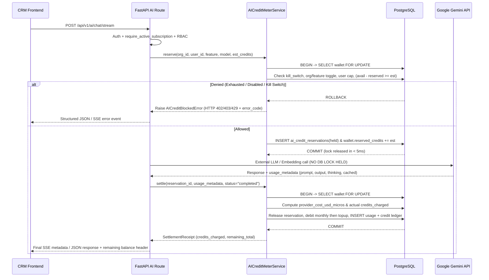

# Super Admin, Billing, AI Credits & Dynamic Storage — Cross-Product Implementation Plan

- **Document Path:** `features/billing/SUPERADMIN_BILLING_AI_CREDITS_AND_STORAGE_IMPLEMENTATION_PLAN.md`
- **Date:** 25 November 2026
- **Status:** PROPOSED IMPLEMENTATION PLAN (Source-Verified Against Codebase)
- **Owning Repositories:**
  - `crusource-crm-backend/` — FastAPI, SQLAlchemy, Alembic (Python 3.12): CRM Billing, Storage Quota Engine, AI Metering/Credits Engine, Org Admin Controls, Internal Central Admin APIs
  - `crusource-crm-frontend/` — Next.js App Router, React, Tailwind: Org Admin AI Usage & Controls, Upgraded Billing & Storage Pages, AI/Upload Quota UX
  - `crusource-vms-backend/` — NestJS / Fastify, TypeScript, Zod (Node 22): Designated Central Admin Backend (`src/modules/admin-crm/`) delegating to CRM via RS256 service JWTs
  - `crusource-admin/` — Central Admin Nx / Next.js Host (`apps/superadmin` + `libs/domains/crm/`): Plans & Pricing Console, Organization Entitlements/Top-Ups/Overrides, Platform AI Cost & Margin Dashboard
- **Related Pricing & Architecture References:**
  - [Revised CRM Pricing Proposal](../../Prices/CRM_PRICING_REVIEW_AND_PROPOSAL.md)
  - [CRM Pricing, AI Credits & Competitive Analysis](../../Prices/CRM_PRICING_AI_CREDITS_AND_COMPETITIVE_ANALYSIS.md)
  - [CRM Application Cost Breakdown](../../Prices/CRM_APPLICATION_COST_BREAKDOWN.md)
  - [Central Admin Phase 1 Architecture](../superadmin/superadmin-phase1/ARCHITECTURE.md)
  - [Central Admin Phase 4 -> Phase 5 Handoff](../superadmin/superadmin-phase4/PHASE_5_HANDOFF.md)
  - [Built-in Super Admin Retirement Plan](../superadmin/BUILT_IN_SUPERADMIN_RETIREMENT_PLAN.md)
- **Skills Applied During Planning & Verification:** `threat-modeling`, `api-security`, `verification-before-completion`

---

## 1. Executive Summary & Architectural Decisions

This plan specifies the end-to-end engineering design to introduce **developer-grade AI cost telemetry**, **enforceable AI credit accounting**, **dynamic per-seat storage quotas (1.5 GB default)**, **Org Admin AI controls**, and **Central Super Admin plan/entitlement management** across the Crusource platform while preserving repository boundaries established in the workspace `AGENTS.md`.

### Core Architectural Decisions

| Decision Area | Chosen Design | Rationale |
| --- | --- | --- |
| **1. Super Admin Ownership & Boundary** | All Super Admin controls live in `crusource-admin` -> `crusource-vms-backend` (`src/modules/admin-crm/`) -> `crusource-crm-backend` (`/api/v1/internal/admin/crm/*`) via RS256 60-second delegated JWTs (`crm-admin-delegation+jwt`). | The built-in CRM Super Admin UI was retired (`571818d3`). `crusource-vms-backend` is the designated Central Admin backend and never queries the CRM PostgreSQL database directly; it validates CRM JSON responses with Zod contracts behind a `CircuitBreaker`. |
| **2. Developer & Super Admin Cost Visibility** | Every Gemini API invocation (all 8 CRM features + Public Website Chat) records raw token counts (`prompt`, `completion`, `thinking`, `cached`, `embedding`) and computes exact USD micro-costs using a DB-backed versioned `ai_model_rate_cards` table (`provider_cost_usd_micros`). | Gives engineering and leadership exact unit cost per feature, per model, per organization, per user, and platform-wide gross margin against per-seat subscription revenue, including public website AI overhead (`org_id = NULL`, `usage_scope = "platform_public"`). |
| **3. AI Credit Model (Org-Wise vs Seat-Wise & Top-Ups)** | **Hybrid Model: Org-Pooled Dual-Bucket Wallet + Optional Org Admin Per-User Monthly Caps.**<br>1. `monthly_plan_credits` (resets each billing cycle; formula `base + per_seat × paid_seats`) — consumed **first**.<br>2. `topup_credits` (purchased or Super Admin–granted packs; rollover-eligible) — consumed **second**.<br>3. Optional Org Admin **Per-User Monthly Caps** (ceilings against the org pool) + **Per-Feature Switches**. | Pure seat-siloed wallets strand unused credits on light users and break shared org top-up packs. Pure unguarded org pools allow one power user to drain the team's budget. Caps over an org pool give Org Admins exact per-seat governance while keeping top-ups shareable and unused credits fluid. |
| **4. Credit Unit Anchoring** | **`1 Credit = $0.001` actual provider API cost** (`credits = max(1, ceil(provider_cost_usd / 0.001))` for paid LLM calls; `$0` cache hits / deterministic fallbacks = `0` credits). | Anchoring credits to provider cost ensures that if an org upgrades from `gemini-2.5-flash` to `gemini-2.5-pro` via Super Admin, credit burn scales automatically (`~4x–5x` per call) without eroding gross margin. |
| **5. Race-Safe AI Credit Enforcement** | **2-Phase Reserve -> External LLM Call -> Atomic Settle** using short PostgreSQL `FOR UPDATE` row locks on `org_ai_credit_wallets`, an `ai_credit_reservations` hold table, an immutable `ai_credit_ledger`, and a 5-minute stale-reservation reaper job in `scheduler_jobs.py`. | Prevents concurrent-request wallet overdrafts without holding PostgreSQL locks open during 2–15 second Gemini HTTP/SSE streams. |
| **6. Dynamic Storage Quota (1.5 GB Default)** | Unified `StorageQuotaService`: `effective_quota_mb = subscription.storage_quota_override_mb ?? (plan.base_storage_mb + plan.storage_per_seat_mb × billable_seats)` with default **`1,536 MB` (`1.5 GB` = `1,610,612,736` bytes)**. Enforced across all **5** storage write paths. | Replaces all hardcoded `10 GB` constants across backend and frontend, fixes the broken `sub.plan.max_storage_gb` attribute reference, eliminates artificial `10 MB` placeholder DB bytes, and closes all 5 unenforced upload/version/attachment/backup write paths. |
| **7. Per-Seat Pricing Alignment** | Aligns `plans` with `CRM_PRICING_REVIEW_AND_PROPOSAL.md` (`trial` = 14-day, 1.5 GB, 200 one-time AI credits; `pro` = per-seat INR/USD pricing with `base + per_seat` storage and AI credits; `custom` = Super Admin–configured overrides) and makes plans editable in Central Admin `/crm/plans`. | Eliminates the mismatch between legacy seeded plans (`Starter`/`Professional`/`Enterprise` with fixed flat prices and no storage/AI fields) and the commercial per-seat model, while remaining payment-gateway-agnostic until Phase 4. |

---

## 2. Current-State Codebase Audit & Verified Gap Inventory

Every file path, symbol, and line number below was verified directly against the current repositories on 25 November 2026.

### 2.1 Complete CRM AI Call-Site Inventory (8 Features + 1 Public Surface)

| # | AI Feature | Entry Route / Trigger | Call Site(s) | Current Model | Current Metering | Current Quota / Subscription Guard | Critical Defects Found |
| --- | --- | --- | --- | --- | --- | --- | --- |
| 1 | **Loop AI Chat (RAG + Stream)** | `POST /api/v1/ai/chat/stream` (`src/modules/ai_chat/routes/ai_routes.py:73`) | `stream_chat_handler.py` -> `GeminiProvider.stream_chat_response()` (`gemini_provider.py:92`) + `VectorRetriever.search()` (`vector_retriever.py:35`) | `OrgSettings.loop_ai_model` (default `gemini-2.5-flash`) + `gemini-embedding-001` | **None** (`usage_metadata` discarded; query embedding untracked) | Only `require_setup_permission("loop_ai_chat")` + `get_user_scope` | **1. Missing `require_active_subscription`!**<br>**2. Thinking-token leak:** `stream_chat_response()` omits `thinking_budget=0` (hidden reasoning tokens billed at `$2.50/1M`).<br>**3. Zero credit enforcement.** |
| 2 | **AI Email Draft & Refinement** | `POST /api/v1/ai/draft-email` (`ai_routes.py:269`) | `draft_email_handler.py` -> `GeminiProvider.generate_structured()` (`gemini_provider.py:217`) | `gemini-2.5-flash` (or provider default) | **Discarded** (`generate_structured` wraps `generate_structured_with_usage` and drops the usage tuple) | `require_draft_rate_limit` + `get_user_scope` | **1. Missing `require_active_subscription`!**<br>**2. Usage tuple thrown away.**<br>**3. Zero credit enforcement.** |
| 3 | **NL Report Builder** | `POST /api/v1/ai/reports/draft` (`ai_routes.py:359`) | `ai_routes.py:371` -> `provider.generate_structured()` | `gemini-2.5-flash` | **Discarded** | `require_reports_read` + `get_user_scope` | **1. Missing `require_active_subscription`!**<br>**2. Serializes full 8-entity `field_registry` every call (high prompt tokens).**<br>**3. Zero credit enforcement.** |
| 4 | **AI Lead Scoring (Single & Batch)** | `lead_scoring_service.py:465-525` & `lead_scoring_nlp_service.py:245-310` | `GeminiProvider.generate_structured_with_usage()` (`gemini_provider.py:239`) | `gemini-2.5-flash` | **Partial:** writes `prompt_tokens`, `completion_tokens`, `total_tokens` to `ai_token_usage_ledger` (`AITokenUsage`) | Checks `OrgSettings.ai_scoring_monthly_token_limit` (500,000 tokens) | **1. Ignores `thoughts_token_count` and `cached_content_token_count`.**<br>**2. Separate token cap silo instead of unified org credit wallet.**<br>**3. SHA-256 cached hits are `$0` (must remain 0 credits).** |
| 5 | **AI Import Column Mapping** | `POST /api/v1/import/ai-map` (`src/modules/data_admin/routes/ai_mapping_routes.py`) | `ai_column_mapping_service.py:286` -> direct `client.aio.models.generate_content(...)` | `gemini-2.5-flash` | **None** | `get_current_user` (does **not** pass `db` or `scope` to `map_columns_with_ai`) | **1. Bypasses `GeminiProvider`.**<br>**2. Missing `thinking_budget=0`.**<br>**3. No `db`/`scope` passed, no `require_active_subscription`, no credit check.** Deterministic `_deterministic_match()` is `$0` and must remain free fallback. |
| 6 | **Vector Embedding Sync** | `POST /api/v1/ai/sync-embeddings` (`ai_routes.py:189`) | `sync_embeddings_handler.py` -> `embedding_service.py` -> `GeminiService.get_embeddings_batch()` | `gemini-embedding-001` | **None** (batches up to 50 records; `$0.15/1M` input tokens untracked) | `require_setup_permission("loop_ai_chat")` + `get_user_scope` | **1. Missing `require_active_subscription`!**<br>**2. Uncapped bulk re-embedding.** Note: `sync_single_record` is text-only DB upsert (`$0`). |
| 7 | **Campaign AI Executive Summary** | `GET /api/v1/campaigns/{id}/ai-summary` (`src/modules/campaigns/handlers/get_campaign_ai_summary_handler.py:140`) | Calls `provider.generate_text(prompt)` | Intended `gemini-2.5-flash` | **None** | Campaign auth | **Broken call:** `GeminiProvider` has no `generate_text()` method; `AttributeError` is silently caught and falls back to `_generate_heuristic_summary()`. Must explicitly decide whether to implement metered `generate_text()` or keep heuristic-only (see Section 10.4). |
| 8 | **Public Website AI Chat** | `POST /api/v1/ai/public-chat` (`ai_routes.py`) | `public_chat_handler.py` -> `GeminiProvider.stream_public_chat_response()` | `gemini-2.5-flash` | **Count-only** (`PUBLIC_AI_GLOBAL_DAILY_LIMIT=1000` in Redis/memory; no token/USD ledger) | Anonymous visitor/IP/global daily count limits | **Developer cost blind spot:** Public website chat burns our Gemini API key without showing up in Super Admin platform AI cost analytics. Must log with `org_id = NULL`, `usage_scope = "platform_public"`. |

### 2.2 Storage Quota Bugs & Unenforced Write Paths

#### Hardcoded `10 GB` Locations (Must All Be Replaced)

| Layer | File & Line | Current Defect |
| --- | --- | --- |
| Backend (Billing) | `crusource-crm-backend/src/modules/billing/handlers/get_org_subscription_handler.py:30` | Hardcodes `10 * 1024 * 1024 * 1024` (`10 GB`) as `storage_quota_bytes`. |
| Backend (Data Admin) | `crusource-crm-backend/src/modules/data_admin/handlers/storage_usage_handler.py:36-41` | Attempts `sub.plan.max_storage_gb` (column does **not** exist on `Plan`), silently swallows `AttributeError`, falls back to `10 GB`, and adds a fabricated `10 MB` `database_bytes`. |
| Backend (Super Admin Projection) | `crusource-crm-backend/src/modules/superadmin/repositories/organization_read_repository.py:33-35` | Computes `document_storage_bytes` by summing **only** `Document.file_size` (`is_deleted=False`), omitting `DocumentVersion`, `Attachment`, and non-Drive `BackupSnapshot`. |
| Frontend (Storage Admin) | `crusource-crm-frontend/src/app/dashboard/admin/storage/page.tsx:15` | `const totalQuota = storage?.total_quota_bytes || 10737418240; // 10 GB` |
| Frontend (Storage Query Fallback) | `crusource-crm-frontend/src/hooks/admin/useDataAdminQueries.ts:90` | Error fallback returns `total_quota_bytes: 10737418240 // 10 GB`. |
| Frontend (Billing Usage Card) | `crusource-crm-frontend/src/components/billing/WorkspaceUsageCard.tsx:37` | `const storageQuota = usage.storage_quota_bytes || 10 * 1024 * 1024 * 1024;` |
| Frontend (Subscription Card) | `crusource-crm-frontend/src/components/billing/CurrentSubscriptionCard.tsx:265-278` | Hardcodes literal `/ 10 GB` label and `10 * 1024 * 1024 * 1024` denominator. |

#### All 5 Storage Write Paths Currently Lacking Org Quota Enforcement

1. `crusource-crm-backend/src/modules/documents/handlers/upload_document_handler.py` — single & batch `Document` uploads via `document_storage_service.save_upload_file()`.
2. `crusource-crm-backend/src/modules/documents/handlers/update_binary_content_handler.py` — binary replacement (`save_bytes` + new `DocumentVersion` + `write_bytes`).
3. `crusource-crm-backend/src/modules/documents/handlers/version_handlers.py` — `update_document_content` (`save_bytes` + new `DocumentVersion` + `write_bytes`).
4. `crusource-crm-backend/src/modules/attachments/handlers/upload_attachment_handler.py` — entity attachments (`storage_service.save_file` + `Attachment`).
5. `crusource-crm-backend/src/modules/data_admin/handlers/data_backup_handler.py` — workspace archive exports (`save_archive` + `BackupSnapshot`, whenever `storage_provider != "google_drive"`).

### 2.3 Super Admin & Central Admin Integration Gaps

- `crusource-vms-backend/src/modules/admin-crm/domain/crm-permissions.ts` and `crusource-crm-backend/src/shared/auth/service_delegation_guard.py` currently support 7 scopes:
  - `crm.organizations.read`, `crm.organizations.export`, `crm.organizations.members.read`, `crm.organizations.audit.read`, `crm.organizations.feedback.read`, `crm.organizations.billing.read`, `crm.organizations.trial.extend`.
- Missing scopes for this initiative: plan catalog read/write, organization entitlement/storage/model overrides, AI usage inspection, AI credit top-up/adjustment grants, and platform AI cost analytics.
- `crusource-admin/libs/domains/crm/src/navigation.ts` already defines `{ path: 'plans', label: 'Plans & Pricing' }`, which currently renders a `<SectionFoundation />` stub in `CrmSectionScreen.tsx`.
- `crusource-admin/libs/domains/crm/src/data/organization-detail-tabs.ts` already defines the `billing` tab (`OrganizationBilling` in `OrganizationInsights.tsx`), which currently renders read-only subscription metadata and trial extension actions.
- Legacy route `crusource-crm-backend/src/modules/superadmin/routes/organization_routes.py` (`/{org_id}/loop-ai-model`) still exists outside the Central Admin delegation boundary and should be superseded by the delegated entitlements endpoint before retirement.

---

## 3. Developer & Super Admin AI Cost Economics

Before enforcing customer credits, engineering and Super Admin must know **exact developer API spend** per feature, per model, and per organization.

### 3.1 Model Rate Card (`ai_model_rate_cards`)

Store model pricing as **integer micro-USD (`1 USD = 1,000,000 micro-USD`) per 1,000,000 tokens** (equivalent to `nano-USD` per token, avoiding floating-point drift) with `effective_from` / `effective_to` versioning so historical cost reports never change when Google updates pricing:

| Model Key | Input (`$/1M`) | Output incl. Thinking (`$/1M`) | Cached Input (`$/1M`) | Embedding (`$/1M`) | `input_micro_usd_per_1m` | `output_micro_usd_per_1m` |
| --- | ---: | ---: | ---: | ---: | ---: | ---: |
| `gemini-2.5-flash` (Default) | `$0.30` | `$2.50` | `$0.03` | — | `300,000` | `2,500,000` |
| `gemini-2.5-flash-lite` | `$0.10` | `$0.40` | `$0.01` | — | `100,000` | `400,000` |
| `gemini-2.5-pro` (<=200k ctx) | `$1.25` | `$10.00` | `$0.125` | — | `1,250,000` | `10,000,000` |
| `gemini-embedding-001` | — | — | — | `$0.15` | `0` | `0` (`embedding: 150,000`) |

> **FX Conversion:** Store `usd_to_inr_rate` (default `86.00`, configurable in platform config) for Super Admin INR margin display while keeping **USD micro-dollars** as the immutable accounting base in PostgreSQL.

### 3.2 Exact Per-Call Cost & Credit Formula

For every AI call returning `usage_metadata`:

```text
billable_input_tokens  = max(0, prompt_token_count - cached_content_token_count)
billable_output_tokens = candidates_token_count + thoughts_token_count

provider_cost_usd_micros = ceil(
    (billable_input_tokens      * rate.input_micro_usd_per_1m
   + cached_content_token_count * rate.cached_input_micro_usd_per_1m
   + billable_output_tokens     * rate.output_micro_usd_per_1m
   + embedding_tokens           * rate.embedding_micro_usd_per_1m) / 1_000_000
)

# 1 AI Credit = $0.001 USD = 1,000 micro-USD of actual provider cost
credits_charged = 0 if provider_cost_usd_micros == 0 else max(1, ceil(provider_cost_usd_micros / 1_000))
```

### 3.3 Estimated Unit Cost Per CRM Feature (with `thinking_budget=0` Fixed)

| Feature Key | Typical Prompt Tokens | Typical Output Tokens | Est. Provider Cost (`gemini-2.5-flash`) | Cost in INR (@ ₹86/$) | Credits Charged (`1 cr = $0.001`) | Cost Impact if `thinking_budget` Leak Is NOT Fixed |
| --- | ---: | ---: | ---: | ---: | ---: | --- |
| `loop_ai_chat` (with RAG + query embed) | 2,500–6,000 | 300–800 | `$0.0015 – $0.0038` | `₹0.13 – ₹0.33` | **2 – 4 credits** | Jumps `2.5x–5x` (`$0.006 – $0.015`) due to 1,500–4,000 invisible thinking tokens |
| `ai_email_draft` | 1,200–2,500 | 250–500 | `$0.0010 – $0.0020` | `₹0.09 – ₹0.17` | **1 – 2 credits** | Already has `thinking_budget=0` in `generate_structured_with_usage` |
| `ai_report_draft` | 3,000–5,500 | 200–450 | `$0.0014 – $0.0028` | `₹0.12 – ₹0.24` | **2 – 3 credits** | Optimizing `field_registry` prompt cuts prompt tokens by ~45% |
| `ai_lead_scoring` (cache miss) | 900–1,800 | 180–350 | `$0.0007 – $0.0014` | `₹0.06 – ₹0.12` | **1 – 2 credits** | SHA-256 cache hits remain **`$0.00` / `0 credits`** |
| `ai_import_mapping` (LLM path) | 1,000–3,000 | 200–600 | `$0.0008 – $0.0024` | `₹0.07 – ₹0.21` | **1 – 3 credits** | Currently leaks thinking tokens via raw SDK call; deterministic match stays **`0 credits`** |
| `ai_embedding_sync` (per 50-record batch) | 8,000–20,000 embed | 0 | `$0.0012 – $0.0030` | `₹0.10 – ₹0.26` | **2 – 3 credits** | Currently completely unbilled & uncapped |
| `campaign_ai_summary` | Heuristic (`$0`) or 1,500/350 | 0 or 350 | `$0.00` (heuristic) or `$0.0013` (LLM) | `₹0.00` or `₹0.11` | **0** (heuristic) or **2** (LLM) | Currently throws `AttributeError` (`generate_text` missing) and silently uses heuristic |
| `public_website_chat` (`platform_public`) | 1,500–3,000 | 200–500 | `$0.0010 – $0.0022` | `₹0.09 – ₹0.19` | **N/A (Platform COGS)** | Tracked separately in Super Admin AI Cost Dashboard so marketing overhead never distorts tenant COGS |

### 3.4 Commercial Alignment & Margin Guardrails (from `Prices/` Docs)

Aligned with [CRM_PRICING_REVIEW_AND_PROPOSAL.md](../../Prices/CRM_PRICING_REVIEW_AND_PROPOSAL.md) and [CRM_PRICING_AI_CREDITS_AND_COMPETITIVE_ANALYSIS.md](../../Prices/CRM_PRICING_AI_CREDITS_AND_COMPETITIVE_ANALYSIS.md):

| Plan Key | Commercial Positioning | Seat Price (Config in Super Admin) | Storage Formula (Default) | AI Credits Formula (Default) | Worst-Case AI COGS / Seat / Month | Target Gross Margin Impact |
| --- | --- | --- | --- | --- | ---: | --- |
| `trial` | 14-Day Free Trial (full CRM evaluation) | `₹0 / $0` | **1.5 GB flat** (`1,536 MB`, `0 MB/seat`) | **200 credits** one-time org pool | `<= $0.20` per trial org (`~₹17`) | Eliminates trial abuse exposure |
| `pro` | Standard Per-Seat Plan | Configurable (tentative `₹549–₹649/seat/mo` or `$9–$12/seat/mo` annual/monthly) | **`1,536 MB` base + `512 MB` / paid seat** *(configurable)* | **`500` base + `400` / paid seat / mo** *(configurable)* | `$0.40/seat` (`~₹34`) at 100% burn | AI COGS stays `< 6.5%` of seat revenue |
| `custom` | Enterprise / High-Volume Custom Quote | Custom contract | Custom Super Admin override (`storage_quota_override_mb`) | Custom Super Admin override + Top-Up Packs | Contract-priced | Guaranteed positive margin |
| **Top-Up Pack (Standard)** | Org-Wide Add-On Credits | Configurable (e.g., `2,500 credits` for `₹799 / $10`) | — | `+2,500` to `topup_credits` bucket | `$2.50` (`~₹215`) max API cost | **`~73–75%` gross margin** on top-ups |

---

## 4. Database Schema & Migration Design (`crusource-crm-backend`)

All schema changes belong strictly to `crusource-crm-backend/` via Alembic, branching cleanly from the verified current head:

- **Verified Current Alembic Head:** `20261120_unified_sales_teamspace_accounts_contacts`
- **Target Migration Revision:** `20261125_billing_ai_credits_and_dynamic_storage` (split into 2 sequential revisions if rolled out in phases: `20261125_01_ai_cost_rate_cards_and_ledger` and `20261125_02_plans_storage_and_ai_wallets`).
- **Mandatory SQLAlchemy Registration:** Every new model class MUST be imported in BOTH:
  1. `crusource-crm-backend/src/main.py` (runtime metadata registration)
  2. `crusource-crm-backend/tests/conftest.py` (SQLite in-memory unit test `Base.metadata.create_all` registration)
- **SQLite Test Compatibility:** Follow existing project conventions (use `UUID(as_uuid=True)` with project dialect compatibility, avoid Postgres-only DDL outside `if bind.dialect.name == "postgresql":` guards, keep `server_default` expressions portable).

### 4.1 Extensions to Existing Tables

#### A. `plans` (`src/modules/billing/repositories/models.py`)

Add configurable per-seat storage, AI credit, and multi-currency pricing columns (keeping `price_monthly` / `price_annual` intact for backward compatibility):

| Column | Type | Default | Purpose |
| --- | --- | --- | --- |
| `price_monthly_inr` | `Numeric(10, 2)` | `0` | Per-seat monthly price in INR |
| `price_annual_inr` | `Numeric(10, 2)` | `NULL` | Per-seat monthly-equivalent annual price in INR |
| `price_monthly_usd` | `Numeric(10, 2)` | `0` | Per-seat monthly price in USD |
| `price_annual_usd` | `Numeric(10, 2)` | `NULL` | Per-seat monthly-equivalent annual price in USD |
| `is_per_seat` | `Boolean` | `True` | Distinguishes per-seat plans (`pro`) from flat/trial plans |
| `is_custom_quote` | `Boolean` | `False` | Marks `custom` / enterprise quote-only tiers |
| `base_storage_mb` | `Integer` | **`1536`** | Base workspace storage quota in MiB (**1.5 GB = 1,536 MiB**) |
| `storage_per_seat_mb` | `Integer` | `0` | Additional MiB added per billable seat (e.g., `512` on `pro`) |
| `monthly_ai_credits_base` | `Integer` | `200` | Base org AI credit pool per cycle (`200` trial, `500` pro) |
| `monthly_ai_credits_per_seat` | `Integer` | `0` | Additional monthly AI credits per billable seat (e.g., `400` on `pro`) |
| `trial_duration_days` | `Integer` | `14` | Default evaluation window length |
| `default_ai_model` | `String(80)` | `"gemini-2.5-flash"` | Default Loop AI model assigned to orgs on this plan |

#### B. `subscriptions` (`src/modules/billing/repositories/models.py`)

Add Super Admin per-organization entitlement overrides and AI governance switches:

| Column | Type | Default | Purpose |
| --- | --- | --- | --- |
| `storage_quota_override_mb` | `Integer`, nullable | `NULL` | Super Admin hard override in MiB (takes precedence over plan formula) |
| `ai_credits_base_override` | `Integer`, nullable | `NULL` | Super Admin override for org base monthly credits |
| `ai_credits_per_seat_override` | `Integer`, nullable | `NULL` | Super Admin override for per-seat monthly credits |
| `ai_enforcement_mode` | `String(20)`, not null | `"shadow"` -> `"enforce"` | `"shadow"` (log-only during Phase 0), `"enforce"` (hard stop at 0), `"unlimited"` (internal/VIP demo orgs) |
| `ai_kill_switch` | `Boolean`, not null | `False` | Instant Super Admin emergency cutoff for all paid AI calls in this org |
| `ai_kill_switch_reason` | `String(255)`, nullable | `NULL` | Audit reason shown to Super Admin & Org Admin |

#### C. `ai_token_usage_ledger` (`src/modules/leads/repositories/lead_scoring_models.py` -> promote/re-export in `src/modules/ai_chat/repositories/ai_usage_models.py`)

Preserve existing table name (`ai_token_usage_ledger`) and existing columns (`id`, `org_id`, `user_id`, `feature`, `model`, `prompt_tokens`, `completion_tokens`, `total_tokens`, `created_at`) so no existing queries break, and evolve it with:

| Column | Type | Default / Constraint | Purpose |
| --- | --- | --- | --- |
| `org_id` | `UUID` | **Alter to `nullable=True`** | Allows `org_id = NULL` for `public_website_chat` (`usage_scope = "platform_public"`) |
| `usage_scope` | `String(30)` | `"tenant"`, indexed | `"tenant"` vs `"platform_public"` vs `"internal_system"` |
| `thinking_tokens` | `Integer` | `0`, not null | Captures Gemini `thoughts_token_count` |
| `cached_tokens` | `Integer` | `0`, not null | Captures Gemini `cached_content_token_count` |
| `embedding_tokens` | `Integer` | `0`, not null | Captures `gemini-embedding-001` input tokens |
| `rate_card_id` | `UUID`, FK -> `ai_model_rate_cards.id` | `NULL` | Pinpoints the exact rate card version used for cost calculation |
| `provider_cost_usd_micros` | `BigInteger` | `0`, not null | Exact developer cost in micro-USD (`1 USD = 1,000,000`) |
| `credits_charged` | `Integer` | `0`, not null | Credits deducted for this call (`0` for cache hits / shadow / public) |
| `wallet_bucket` | `String(20)` | `NULL` | `"monthly"`, `"topup"`, `"split"`, `"free_cache"`, `"platform_public"` |
| `request_id` | `String(64)` | `NULL`, indexed | Correlates multi-step requests (e.g., RAG embedding + chat stream) |
| `status` | `String(20)` | `"completed"` | `"completed"`, `"failed"`, `"aborted"`, `"cache_hit"` |
| `latency_ms` | `Integer` | `NULL` | Provider call duration for performance monitoring |
| `metadata_json` | `JSON` | `NULL` | Non-PII diagnostics (e.g., `batch_size`, `entity_type`, `fallback_used`) |

Indexes: `(org_id, created_at DESC)`, `(org_id, feature, created_at DESC)`, `(org_id, user_id, created_at DESC)`, `(usage_scope, created_at DESC)`.

#### D. `org_settings` (`src/modules/org_settings/repositories/models.py`)

Add Org Admin AI governance defaults (keeping `ai_scoring_monthly_token_limit` temporarily during Phase 2 migration, then marking deprecated):

| Column | Type | Default | Purpose |
| --- | --- | --- | --- |
| `ai_enabled` | `Boolean` | `True` | Org Admin workspace-level AI toggle |
| `ai_feature_toggles` | `JSON` | `{"loop_ai_chat": true, "ai_email_draft": true, "ai_report_draft": true, "ai_lead_scoring": true, "ai_import_mapping": true, "ai_embedding_sync": true}` | Per-feature Org Admin switches |
| `ai_user_cap_mode` | `String(20)` | `"shared_pool"` | `"shared_pool"` (no per-user cap) vs `"per_user_caps"` (enforce `default_user_monthly_credit_cap` & per-user overrides) |
| `ai_default_user_monthly_cap` | `Integer`, nullable | `NULL` | Default monthly cap per user when `ai_user_cap_mode == "per_user_caps"` |
| `ai_alert_thresholds` | `JSON` | `[80, 95, 100]` | Org Admin usage alert thresholds (%) |

### 4.2 New Tables

#### 1. `ai_model_rate_cards`
- `id` (UUID PK), `provider` (`"google_gemini"`), `model_key` (String 80, indexed), `input_micro_usd_per_1m` (BigInt), `output_micro_usd_per_1m` (BigInt), `cached_input_micro_usd_per_1m` (BigInt), `embedding_micro_usd_per_1m` (BigInt), `is_active` (Boolean), `effective_from` (DateTime tz), `effective_to` (DateTime tz, nullable), `notes` (String 255), `created_at`.
- Seeded in Alembic migration with verified rates for `gemini-2.5-flash`, `gemini-2.5-flash-lite`, `gemini-2.5-pro`, and `gemini-embedding-001`.

#### 2. `org_ai_credit_wallets` (1 row per organization)
- `org_id` (UUID PK, FK `organizations.id` CASCADE)
- `monthly_allowance_credits` (Integer, not null, default `200`) — computed snapshot for current cycle
- `monthly_used_credits` (Integer, not null, default `0`)
- `topup_balance_credits` (Integer, not null, default `0`) — remaining rollover/top-up credits
- `reserved_credits` (Integer, not null, default `0`) — currently in-flight reservations
- `cycle_start` (DateTime tz, not null)
- `cycle_end` (DateTime tz, not null)
- `last_alert_threshold_sent` (Integer, nullable) — prevents duplicate 80%/95%/100% alert spam within a cycle
- `updated_at` (DateTime tz)
- Check constraints (Postgres): `monthly_used_credits >= 0`, `topup_balance_credits >= 0`, `reserved_credits >= 0`.

#### 3. `ai_credit_reservations` (In-flight holds)
- `id` (UUID PK)
- `org_id` (UUID, FK `organizations.id` CASCADE, indexed)
- `user_id` (UUID, FK `users.id` SET NULL, nullable, indexed)
- `feature` (String 50, not null)
- `reserved_credits` (Integer, not null)
- `status` (String 20, not null: `"held"`, `"settled"`, `"released"`, `"expired"`)
- `expires_at` (DateTime tz, not null, indexed) — default `now + 5 minutes`
- `created_at` (DateTime tz)

#### 4. `ai_credit_ledger` (Immutable double-entry credit journal)
- `id` (UUID PK)
- `org_id` (UUID, FK `organizations.id` CASCADE, indexed)
- `user_id` (UUID, FK `users.id` SET NULL, nullable)
- `actor_type` (String 20: `"crm_user"`, `"org_admin"`, `"super_admin"`, `"system_scheduler"`)
- `actor_ref` (String 128, nullable — stores Central Admin actor ID/email for Super Admin grants)
- `entry_type` (String 30: `"cycle_grant"`, `"cycle_reset"`, `"usage_debit"`, `"topup_purchase"`, `"superadmin_grant"`, `"superadmin_revoke"`, `"refund"`)
- `bucket` (String 20: `"monthly"`, `"topup"`)
- `delta_credits` (Integer, not null — positive for credit, negative for debit)
- `balance_after_monthly` (Integer, not null)
- `balance_after_topup` (Integer, not null)
- `usage_log_id` (UUID, FK `ai_token_usage_ledger.id` SET NULL, nullable)
- `idempotency_key` (String 128, unique, nullable) — guarantees Super Admin top-up grants / cycle resets cannot double-credit on retry
- `reason` (String 500, nullable)
- `expires_at` (DateTime tz, nullable — optional top-up pack expiry support)
- `created_at` (DateTime tz, not null, indexed)

#### 5. `user_ai_credit_limits` (Optional Org Admin Per-User Split / Cap Overrides)
- `id` (UUID PK)
- `org_id` (UUID, FK `organizations.id` CASCADE, indexed)
- `user_id` (UUID, FK `users.id` CASCADE, indexed)
- `monthly_credit_cap` (Integer, nullable — `0` = AI blocked for user; `NULL` = inherit org default cap or unlimited pool)
- `is_ai_blocked` (Boolean, not null, default `False`)
- `allowed_features` (JSON, nullable — optional subset override)
- `updated_by_user_id` (UUID, FK `users.id` SET NULL, nullable)
- `updated_at` (DateTime tz)
- Unique constraint: `uq_user_ai_credit_limit (org_id, user_id)`.

---

## 5. AI Credit Metering & Enforcement Engine

### 5.1 How Org-Wise Pooling, Admin Splitting & Top-Ups Work Together

1. **Monthly Cycle Allowance Calculation:**
   - For `trialing` orgs: `monthly_allowance_credits = override_base ?? plan.monthly_ai_credits_base` (default **200** one-time for trial; does not auto-refill on trial extension unless Super Admin explicitly grants bonus credits).
   - For `active` paid orgs: `monthly_allowance_credits = (override_base ?? plan.monthly_ai_credits_base) + (override_per_seat ?? plan.monthly_ai_credits_per_seat) * billable_seats`, where `billable_seats = max(subscription.seat_count or 0, active_users_count)`.
   - When a seat is added mid-cycle, the delta `+per_seat_credits` is credited immediately via a `cycle_grant` ledger row (prorated or full per commercial toggle).
2. **Consumption Waterfall:**
   - Every settled debit consumes `monthly_remaining = max(0, monthly_allowance_credits - monthly_used_credits)` **first**.
   - Any remainder automatically spills into `topup_balance_credits` **second**.
   - Unused `monthly_plan_credits` expire at cycle end (`cycle_reset`), while `topup_balance_credits` carry forward across cycles.
3. **Org Admin Credit Splitting (Per-User Caps):**
   - **Mode A — `shared_pool` (Default):** Any permitted user draws from the org wallet until the org hits 0. Zero setup friction for small teams.
   - **Mode B — `per_user_caps` (Optional Admin Governance):** Org Admin sets an org-wide `ai_default_user_monthly_cap` (e.g., `300 credits/user/mo`) and/or per-user overrides in `user_ai_credit_limits` (e.g., Sales VP = `1,500`, SDR = `400`, Intern = `0`).
   - User spend is computed for the active cycle from `ai_token_usage_ledger` (`SUM(credits_charged) WHERE org_id = ? AND user_id = ? AND created_at >= wallet.cycle_start`) plus user's active held reservations.
   - **Why Caps Beat Hard Sub-Wallets:** If a rep only uses 120 of their 400 cap, the remaining 280 stays available in the org pool for active closers instead of expiring unused, and org top-up packs immediately unlock usage without manually redistributing balances to 30 employees.

### 5.2 Race-Safe 2-Phase Reserve -> Call -> Settle Protocol



### 5.3 Mandatory Fixes Inside `crusource-crm-backend/src/modules/ai_chat/`

1. **Fix Thinking-Token Leak (`gemini_provider.py` & `ai_column_mapping_service.py`):**
   - Set `thinking_config=types.ThinkingConfig(thinking_budget=0)` on `GeminiProvider.stream_chat_response()` and `stream_public_chat_response()`, and refactor `ai_column_mapping_service.py:286` to route through `GeminiProvider.generate_structured_with_usage()` instead of calling `client.aio.models.generate_content()` directly.
2. **Capture Full `UsageMetadata` in `GeminiProvider`:**
   - Introduce a typed `AIUsageMetrics` dataclass: `model`, `prompt_tokens`, `completion_tokens`, `thinking_tokens`, `cached_tokens`, `embedding_tokens`, `total_tokens`, `latency_ms`.
   - In `stream_chat_response()` and `stream_public_chat_response()`, inspect `chunk.usage_metadata` on every chunk (the final chunk carries cumulative counts) and emit a final structured internal usage record into the handler's `finally` block so even client-aborted SSE streams settle the actual tokens generated up to disconnect.
   - Update `GeminiService.get_embeddings_batch()` and `get_query_embedding()` to estimate/capture exact input token counts (using Gemini `count_tokens` or deterministic `ceil(chars / 4)` fallback when SDK omits embedding usage metadata) and attach them to the same `request_id`.
3. **Add Missing `require_active_subscription` Guards:**
   - Apply `Depends(require_active_subscription)` to `POST /api/v1/ai/chat/stream`, `POST /api/v1/ai/draft-email`, `POST /api/v1/ai/reports/draft`, `POST /api/v1/ai/sync-embeddings`, and `POST /api/v1/import/ai-map` (expired trials must not burn Gemini API quota).
4. **Preserve Free Fallbacks When Credits = 0:**
   - `ai_lead_scoring`: SHA-256 cached scores still return immediately at `0 credits`.
   - `ai_import_mapping`: When credits are exhausted or AI is toggled off, fall back cleanly to `_deterministic_match()` and return `mapping_source: "deterministic_fallback"` with a UI banner instead of blocking CSV imports.
   - `campaign_ai_summary`: Keep `_generate_heuristic_summary()` as free fallback; only invoke billable LLM if explicitly enabled and credits remain.
5. **Stale Reservation Sweeper & Cycle Reset Job (`src/shared/services/scheduler/scheduler_jobs.py`):**
   - Every **5 minutes**: mark `ai_credit_reservations` with `status='held' AND expires_at < now()` as `'expired'` and decrement `org_ai_credit_wallets.reserved_credits` under row lock.
   - Hourly / daily: roll over `cycle_start`/`cycle_end` for active paid subscriptions whose `cycle_end <= now()`, resetting `monthly_used_credits = 0` and recalculating `monthly_allowance_credits` from the active plan + seat count + overrides (idempotent via `idempotency_key = f"cycle_reset:{org_id}:{cycle_start.isoformat()}"`).
6. **Deprecate Legacy `ai_scoring_monthly_token_limit`:**
   - Phase 0–1: Keep `ai_scoring_monthly_token_limit` working while shadow-logging credits.
   - Phase 2: Switch `lead_scoring_service.py` to `AICreditMeterService` (feature=`ai_lead_scoring`), deprecate `ai_scoring_monthly_token_limit` in billing responses while retaining the field as nullable/legacy until frontend migrates.

---

## 6. Dynamic Storage Quota Engine (Default 1.5 GB)

### 6.1 Single Source of Truth: `StorageQuotaService`

Create `crusource-crm-backend/src/modules/billing/services/storage_quota_service.py` consumed by **Billing**, **Data Admin**, **Documents**, **Attachments**, and **Super Admin Projections**:

```text
DEFAULT_BASE_STORAGE_MB = 1536  # 1.5 GiB = 1,610,612,736 bytes

def resolve_storage_quota_bytes(db, org_id) -> StorageQuotaSnapshot:
    1. Load Subscription + Plan (or default to Trial plan defaults if none).
    2. Determine billable_seats = max(sub.seat_count or 0, active_users_count).
    3. Compute effective_mb:
       - If sub.storage_quota_override_mb is not None:
             effective_mb = sub.storage_quota_override_mb
             source = "superadmin_override"
       - Else if plan exists:
             effective_mb = plan.base_storage_mb + (plan.storage_per_seat_mb * billable_seats)
             source = "plan_formula"
       - Else:
             effective_mb = 1536  # 1.5 GB default
             source = "system_default"
    4. Compute live usage bytes (single SQL query or cached 30s in Redis, bypassed on write checks):
       - documents_bytes   = SUM(Document.file_size WHERE org_id = ? AND is_deleted = False)
       - versions_bytes    = SUM(DocumentVersion.file_size WHERE org_id = ? AND parent doc is_deleted = False)
       - attachments_bytes = SUM(Attachment.file_size WHERE org_id = ?)
       - backups_bytes     = SUM(BackupSnapshot.file_size_bytes WHERE org_id = ? AND storage_provider != 'google_drive' AND status = 'completed')
       - used_bytes        = documents_bytes + versions_bytes + attachments_bytes + backups_bytes
       (Remove fabricated 10 MB database_bytes placeholder from storage_usage_handler.py!)
```

> **Note on `Document` vs `DocumentVersion` double-counting:** Inspect whether the current active version is stored in BOTH `Document.file_size` and `DocumentVersion.file_size` during upload/versioning. If `DocumentVersion` stores *all* versions including v1, sum `DocumentVersion.file_size` for docs that have versions + `Document.file_size` only for legacy docs without version rows (verify with a unit test in `test_documents_and_s3.py` so current files are never double-counted).

### 6.2 Atomic Write Enforcement Across All 5 Paths

Add `assert_storage_quota(db, org_id, incoming_bytes, *, replace_bytes=0)` with a PostgreSQL transaction-scoped advisory lock `pg_advisory_xact_lock(hashtext(f"storage_quota:{org_id}"))` (no-op on SQLite unit tests) to eliminate race conditions between parallel multi-file uploads:

| # | Write Path File | Enforcement Hook | Failure & Cleanup Behavior |
| --- | --- | --- | --- |
| 1 | `src/modules/documents/handlers/upload_document_handler.py` | Pre-check batch total before writing; re-verify actual streamed byte size before DB commit. | Return HTTP `413` / `507` with `error_code: "STORAGE_QUOTA_EXCEEDED"` + `used_bytes`, `quota_bytes`, `required_bytes`. Delete any already-written S3/local temp object on failure. |
| 2 | `src/modules/documents/handlers/update_binary_content_handler.py` | Check `incoming_bytes` (full new version size since previous version is preserved in `DocumentVersion`). | Reject before `save_bytes` / `write_bytes`; return `STORAGE_QUOTA_EXCEEDED`. |
| 3 | `src/modules/documents/handlers/version_handlers.py` (`update_document_content`) | Check `incoming_bytes` before persisting new `DocumentVersion`. | Reject cleanly; no orphaned version file. |
| 4 | `src/modules/attachments/handlers/upload_attachment_handler.py` | Check `file_size` before `storage_service.save_file()` and verify actual bytes written before commit. | Delete written object on overflow; return `STORAGE_QUOTA_EXCEEDED`. |
| 5 | `src/modules/data_admin/handlers/data_backup_handler.py` | When `storage_provider != "google_drive"`, check estimated/actual archive size before finalizing `BackupSnapshot`. | Abort & remove local/S3 archive if over quota; suggest Google Drive export or quota upgrade. |

### 6.3 Fix Super Admin & Frontend Storage Projections

- **`organization_read_repository.py`:** Replace the `Document.file_size`-only subquery with the unified storage usage calculation (or add `total_storage_bytes` + `storage_quota_bytes` alongside `document_storage_bytes` for backward compatibility, updating `storage_scope` contract cleanly).
- **Frontend (`crusource-crm-frontend`):**
  - Remove all four hardcoded `10 GB` fallbacks (`src/app/dashboard/admin/storage/page.tsx:15`, `src/hooks/admin/useDataAdminQueries.ts:90`, `src/components/billing/WorkspaceUsageCard.tsx:37`, `src/components/billing/CurrentSubscriptionCard.tsx:265-278`).
  - Use `storage_quota_bytes` directly from the API (showing a neutral loading skeleton when undefined instead of fabricating `10 GB`, and formatting dynamically with `formatStorageBytes()` so `1.5 GB`, `4.0 GB`, etc. render cleanly).
  - Surface `STORAGE_QUOTA_EXCEEDED` clearly inside `UploadDocumentModal.tsx` with remaining space and a link to `/dashboard/admin/storage` or `/dashboard/billing`.

---

## 7. Cross-Repository API & UI Contracts

### 7.1 `crusource-crm-backend` — Tenant APIs (Org Admin & CRM Users)

| Method & Endpoint | Guard | Purpose |
| --- | --- | --- |
| `GET /api/v1/billing/subscription` | `get_user_scope` | Extend `usage` payload with `storage_quota_bytes`, `storage_quota_source`, `ai_credits_monthly_allowance`, `ai_credits_monthly_used`, `ai_credits_topup_balance`, `ai_credits_reserved`, `ai_credits_total_remaining`, `ai_cycle_end`, `ai_enforcement_mode`, `ai_kill_switch`. |
| `GET /api/v1/ai/usage/summary` | `get_user_scope` (scoped to self for non-admins; full org for Org Admin / `require_setup_permission("billing")`) | Returns current cycle credit wallet, user's own usage & cap (if enabled), feature breakdown (credits + call count — **does NOT expose our internal USD provider cost to tenants!**), and daily trend. |
| `GET /api/v1/admin/ai-controls/overview` | `require_setup_permission("billing")` (Org Admin) | Full org AI dashboard: wallet buckets, burn rate, per-feature usage, per-member usage table, alert thresholds, recent credit ledger entries (`cycle_grant`, `topup_purchase`, `superadmin_grant`). |
| `PATCH /api/v1/admin/ai-controls/policy` | `require_setup_permission("billing")` (Org Admin) | Toggle `ai_enabled`, `ai_feature_toggles`, `ai_user_cap_mode` (`shared_pool` / `per_user_caps`), `ai_default_user_monthly_cap`, `ai_alert_thresholds`. Writes audit log entry. |
| `PUT /api/v1/admin/ai-controls/users/{user_id}/limit` | `require_setup_permission("billing")` (Org Admin) | Create/update per-user `monthly_credit_cap`, `is_ai_blocked`, and `allowed_features` (verifies target `user_id` belongs to `scope.org_id`). |
| `GET /api/v1/data-admin/storage-usage` | `get_user_scope` | Returns live `used_bytes`, `total_quota_bytes` (from `StorageQuotaService`), `quota_source`, `documents_bytes`, `versions_bytes`, `attachments_bytes`, `backups_bytes` (no fake 10 MB DB bytes). |

> **Commercial Confidentiality Rule:** Tenant-facing CRM endpoints MUST ONLY expose **AI Credits** and call counts — NEVER expose `provider_cost_usd_micros`, model rate cards, or developer gross margins to tenant Org Admins. Raw token counts and USD/INR costs are strictly Super Admin–only.

### 7.2 `crusource-crm-backend` — Internal Central Admin Delegated APIs

All routes live under `/api/v1/internal/admin/crm/*` and use `require_crm_service_actor(required_scope)` (`src/shared/auth/service_delegation_guard.py`) with camelCase `Contract` Pydantic models matching `internal_organization_queries.py`:

| Method & Internal CRM Endpoint | New Delegation Scope | Purpose |
| --- | --- | --- |
| `GET /api/v1/internal/admin/crm/plans` | `crm.plans.read` | List all CRM plans (`trial`, `pro`, `custom`, inactive) with seat pricing, storage formula, and AI credit formula. |
| `POST /api/v1/internal/admin/crm/plans` | `crm.plans.manage` | Create a new plan tier. |
| `PATCH /api/v1/internal/admin/crm/plans/{plan_id}` | `crm.plans.manage` | Update per-seat pricing (INR/USD), `base_storage_mb`, `storage_per_seat_mb`, `monthly_ai_credits_base`, `monthly_ai_credits_per_seat`, `default_ai_model`, `is_active`. |
| `PATCH /api/v1/internal/admin/crm/organizations/{org_id}/entitlements` | `crm.organizations.billing.write` | Assign/change org `plan_id`, `billing_cycle`, `seat_count`, `status`, `storage_quota_override_mb`, `ai_credits_base_override`, `ai_credits_per_seat_override`, `loop_ai_model`, `ai_enforcement_mode`, `ai_kill_switch` + `reason`. Writes `SubscriptionHistory` + audit log. |
| `GET /api/v1/internal/admin/crm/organizations/{org_id}/ai-usage` | `crm.organizations.ai_usage.read` | Returns org wallet buckets, per-feature token/cost/credit breakdown, top consuming users, recent `ai_credit_ledger` transactions, and current enforcement settings. |
| `POST /api/v1/internal/admin/crm/organizations/{org_id}/ai-credits/grant` | `crm.organizations.ai_credits.grant` | Grant or deduct top-up/bonus credits (`delta_credits`, `bucket="topup"`, `entry_type`, `reason`, `idempotency_key`, optional `expires_at`). |
| `GET /api/v1/internal/admin/crm/ai-costs/overview` | `crm.ai_costs.read` | **Developer / Super Admin Cost Analytics:** Date-range platform totals (total tokens, thinking tokens, cached tokens, embedding tokens, total USD & INR cost), breakdown by **feature**, by **model**, by **top organizations** (with estimated seat revenue vs AI COGS margin), plus separate **Public Website AI** cost bucket. |
| `GET /api/v1/internal/admin/crm/ai-rate-cards` & `POST .../ai-rate-cards` | `crm.ai_costs.read` / `crm.plans.manage` | View and version Gemini model rate cards without code deployments. |

### 7.3 `crusource-vms-backend` (`src/modules/admin-crm/` — NestJS / Fastify, Node 22)

Strictly follow Avinash's team's existing DDD architecture in `src/modules/admin-crm/`:

1. **Domain (`domain/crm-permissions.ts`):**
   - Add the 6 new scopes in lockstep with `service_delegation_guard.py`:
     - `crm.plans.read`, `crm.plans.manage`, `crm.organizations.billing.write`, `crm.organizations.ai_usage.read`, `crm.organizations.ai_credits.grant`, `crm.ai_costs.read`.
   - Map scopes to Central Admin platform roles (`SUPER_ADMIN` gets all; `SUPPORT_ADMIN` / `FINANCE_ADMIN` read-only scopes as appropriate per existing role matrix).
2. **Domain Contracts (`domain/billing-ai-contract.ts` + extend `organization-contract.ts`):**
   - Strict Zod schemas validating every CRM internal response (plan catalog, org billing/entitlements summary including storage quota & AI wallet, org AI usage breakdown, credit grant receipt, platform AI cost overview, rate cards).
3. **Infrastructure (`infrastructure/crm-organization.client.ts` or sibling `crm-billing-ai.client.ts`):**
   - Reuse existing `AdminDelegationTokenService` (RS256 60s JWT) and `CircuitBreaker`.
   - Forward `Idempotency-Key` header on `POST .../ai-credits/grant` and `X-Platform-Actor-Id` / `X-Platform-Actor-Email` inside verified JWT claims so CRM audit logs record which Super Admin executed each override or grant.
4. **Application (`application/queries/` & `application/commands/`):**
   - Separate query & command handlers matching existing `organization-query` / `trial-extension` conventions.
   - Persist Central Admin–side audit entries in VMS platform audit logs for every mutation (`plan.updated`, `org.entitlements.updated`, `org.ai_credits.granted`, `org.ai_kill_switch.toggled`).
5. **Presentation (`presentation/`):**
   - Extend `organizations.controller.ts` with `PATCH /api/v1/admin/crm/organizations/:orgId/entitlements`, `GET /api/v1/admin/crm/organizations/:orgId/ai-usage`, and `POST /api/v1/admin/crm/organizations/:orgId/ai-credits/grant`.
   - Add `plans.controller.ts` (`/api/v1/admin/crm/plans`) and `ai-costs.controller.ts` (`/api/v1/admin/crm/ai-costs/overview`, `/api/v1/admin/crm/ai-rate-cards`).
   - Register all new controllers/handlers in `admin-crm.module.ts`.

### 7.4 `crusource-admin` (`libs/domains/crm/` — Central Admin Next.js Frontend)

Follow `@crusource/domain/*`, `@crusource/shared/*`, and `@crusource/ui/*` boundaries:

1. **Wire `/crm/plans` (`Plans & Pricing`):**
   - Replace `<SectionFoundation />` stub for `section === 'plans'` in `CrmSectionScreen.tsx` with a dedicated `CrmPlansScreen` inside `libs/domains/crm/src/components/plans/`.
   - Features: Editable plan cards/table (`Trial`, `Pro`, `Custom`) configuring INR/USD per-seat pricing, `base_storage_mb` (1.5 GB default), `storage_per_seat_mb`, `monthly_ai_credits_base`, `monthly_ai_credits_per_seat`, `default_ai_model`, and AI Model Rate Card drawer.
2. **Enhance `/crm/organizations/[id]` -> `Billing` Tab (`OrganizationInsights.tsx`):**
   - Add **Entitlements & Overrides Panel**: Change plan/status/seat count, set `storage_quota_override_mb` (with live used vs effective quota meter), override AI monthly base/per-seat credits, change `loop_ai_model`, switch `ai_enforcement_mode`, and toggle **AI Kill Switch** (with mandatory reason confirmation dialog).
   - Add **AI Credit Wallet & Top-Up Panel**: View Monthly vs Top-Up balance, grant/adjust top-up credits with reason + auto-generated idempotency key, view per-feature token/cost/credit table and per-user top consumers, plus credit ledger history.
3. **Add Platform AI Cost & Margin View (under `/crm/ai-costs` or embedded tab in `/crm` overview + nav entry in `navigation.ts`):**
   - KPI cards: Total AI API Spend (USD & INR), Total Tokens (Prompt / Output / Thinking / Cached / Embeddings), Platform Public Website AI Spend, Highest-Burn Organizations, and Org AI COGS % of Seat Revenue.
   - Breakdown charts/tables: Cost by Feature (`loop_ai_chat`, `ai_email_draft`, `ai_report_draft`, `ai_lead_scoring`, `ai_import_mapping`, `ai_embedding_sync`, `public_website_chat`) and Cost by Model (`gemini-2.5-flash` vs `gemini-2.5-pro`).

### 7.5 `crusource-crm-frontend` (Tenant CRM UI)

1. **Upgraded `/dashboard/billing` (`WorkspaceUsageCard.tsx`, `CurrentSubscriptionCard.tsx`):**
   - Replace hardcoded `10 GB` with live dynamic storage quota (`1.5 GB` default, scaling per seat or Super Admin override) + breakdown tooltip.
   - Replace `AI Scoring Tokens (This Month)` card with **AI Credits Wallet** card showing Monthly Pool + Top-Up Balance remaining, cycle reset date, and link to **Manage AI Controls**.
2. **New Org Admin **AI Usage & Controls** Screen (`/dashboard/admin/ai-usage` or tab under Admin Hub & Billing):**
   - Guarded by Org Admin `billing` setup permission.
   - Displays org credit balance (Monthly + Top-Up), usage by feature, usage by team member, credit ledger history (cycle grants & top-ups), **Per-Feature AI Switches**, **Shared Pool vs Per-User Monthly Caps** toggle, per-user cap editor table, and **80%/95%/100% alert thresholds**.
   - Shows a clear banner if Super Admin has engaged `ai_kill_switch`.
3. **Graceful Quota-Exhausted UX Across AI & Upload Surfaces:**
   - `useAIChatStreamMutation.ts` / `LoopAISidePanel.tsx`, Email Draft modal, NL Report Builder, Lead Scoring panel, Import Mapping wizard: handle structured `AI_CREDITS_EXHAUSTED`, `AI_USER_CAP_REACHED`, `AI_FEATURE_DISABLED`, and `AI_KILL_SWITCH_ACTIVE` responses with actionable messages (e.g., *"Monthly AI credits used up — ask your Workspace Admin for a top-up"* or *"You reached your monthly personal AI limit"*).
   - `UploadDocumentModal.tsx` & Attachment/Backup upload triggers: surface `STORAGE_QUOTA_EXCEEDED` with remaining MiB and link to `/dashboard/admin/storage`.

---

## 8. Cross-Module Dependency & Blast-Radius Matrix

This matrix maps both **upstream dependencies** (modules our work relies on) and **downstream dependents** (modules and existing tests affected by our changes).

### 8.1 Upstream Dependencies (What We Depend On)

| Repository | Upstream Module / File | Dependency Role | Compatibility Risk & Mitigation |
| --- | --- | --- | --- |
| `crusource-crm-backend` | `src/shared/auth/guards.py` (`get_user_scope`, `require_setup_permission`, `require_active_subscription`) | Tenant isolation, Org Admin RBAC, expired-trial blocking | Adding `require_active_subscription` to AI routes may break existing AI tests that don't seed an active/trial subscription -> verify `conftest.py` test org fixture seeds a valid trial subscription. |
| `crusource-crm-backend` | `src/shared/auth/service_delegation_guard.py` (`require_crm_service_actor`) | RS256 Central Admin JWT validation & scope enforcement | New scopes MUST be registered in `ALLOWED_SCOPES` in lockstep with `crusource-vms-backend/src/modules/admin-crm/domain/crm-permissions.ts`. |
| `crusource-crm-backend` | `src/shared/services/scheduler/scheduler_jobs.py` | Background jobs for stale reservation cleanup & billing cycle rollover | Ensure jobs are idempotent and safe under multi-worker ECS deployments (use DB row locks / advisory locks). |
| `crusource-crm-backend` | `src/modules/org_settings/repositories/models.py` (`OrgSettings`) | Holds `loop_ai_model`, `lead_scoring_enabled`, new Org Admin AI policy fields | Avoid breaking existing `GET/PATCH /api/v1/org-settings` responses; add fields with explicit `server_default`s. |
| `crusource-vms-backend` | `src/modules/admin-crm/infrastructure/crm-organization.client.ts` & platform auth/audit modules | RS256 delegation signing, circuit breaker, Central Admin RBAC | Do not bypass `CircuitBreaker` or Zod validation; keep timeout budgets realistic for aggregation queries (`ai-costs/overview`). |
| `crusource-admin` | `libs/shared/auth`, `libs/ui`, `libs/domains/crm/src/api/organizations.api.ts` | Central Admin session, UI primitives, TanStack Query API hooks | Preserve `@crusource/*` Nx lint boundaries; do not introduce cross-domain imports into `libs/domains/vms`. |

### 8.2 Downstream Dependents & Affected Test Suites (Blast Radius)

| Module Being Changed | Downstream Code Dependents | Existing Test Suites Requiring Verification / Update |
| --- | --- | --- |
| **`Plan` & `Subscription` models + `GetOrgSubscriptionQueryHandler`** | `billing_routes.py`, `subscription_access` guard, `src/modules/data_admin/handlers/storage_usage_handler.py`, `src/modules/superadmin/repositories/organization_read_repository.py`, `src/modules/superadmin/repositories/organization_insights_repository.py`, `crusource-crm-frontend` (`WorkspaceUsageCard.tsx`, `CurrentSubscriptionCard.tsx`, `src/hooks/useBilling.ts`) | `crusource-crm-backend/tests/test_billing_module.py`, `test_subscription_access.py`, `test_internal_admin_organizations.py`, `test_internal_admin_organizations_postgres.py`, `test_internal_trial_extension.py`; `crusource-crm-frontend` billing component & translation contract tests |
| **`GeminiProvider` (`gemini_provider.py`)** | `stream_chat_handler.py`, `draft_email_handler.py`, `ai_routes.py` (`reports/draft`), `lead_scoring_nlp_service.py`, `public_chat_handler.py`, `ai_column_mapping_service.py`, `get_campaign_ai_summary_handler.py` | `test_ai_chat.py`, `test_ai_chat_lifecycle.py`, `test_ai_capability_permissions.py`, `test_draft_email_handler.py`, `test_duplicate_contact_lead_and_ai_email.py`, `test_lead_scoring_nlp.py`, `test_ai_column_mapping.py`, `test_campaign_ai_summary.py`, `test_public_ai_usage.py` |
| **`AITokenUsage` (`ai_token_usage_ledger`)** | `lead_scoring_service.py`, `get_org_subscription_handler.py` (monthly token telemetry), new `AICreditMeterService`, Super Admin cost aggregations | `test_lead_scoring_nlp.py`, `test_billing_module.py`, `tests/conftest.py` (model import list) |
| **5 Storage Write Handlers + `StorageQuotaService`** | `documents` module (upload, binary replace, versioning, deal stage checklist), `attachments` module, `data_admin` (storage page + backup archive), `superadmin` org metrics | `test_documents_and_s3.py`, `test_document_storage_identity.py`, `test_deal_document_checklist.py`, `test_deal_stage_document_requirements.py`, `test_google_auth_and_documents.py` |
| **`crusource-vms-backend/src/modules/admin-crm/`** | `crusource-admin` `libs/domains/crm/` API client & organization detail / plans pages | `domain/crm-permissions.spec.ts`, `infrastructure/crm-organization.client.spec.ts`, `infrastructure/admin-authority.repository.spec.ts`, `presentation/crm-admin.guard.spec.ts`, `application/queries/organization-query.spec.ts` |

---

## 9. Security, STRIDE Threat Model & OWASP API Top 10:2023 Mitigations

*(Applied skills: `threat-modeling`, `api-security`)*

### 9.1 Trust Boundaries

1. **Boundary A — Tenant User <-> `crusource-crm-backend`:** Untrusted browser session; strictly scoped by `Scope(org_id, user_id, role)` + `require_active_subscription` + RBAC (`require_setup_permission("billing")`).
2. **Boundary B — Anonymous Visitor <-> `/api/v1/ai/public-chat`:** Untrusted internet traffic; isolated via IP/visitor/global daily caps, `usage_scope="platform_public"`, zero access to tenant DB records.
3. **Boundary C — `crusource-admin` <-> `crusource-vms-backend` <-> `crusource-crm-backend` (`/api/v1/internal/admin/crm/*`):** Cross-service boundary authenticated via short-lived (60s) RS256 `crm-admin-delegation+jwt` with explicit `iss`, `aud`, `act`, `product: "crm"`, and per-endpoint `scope` claims.

### 9.2 STRIDE & OWASP API Top 10:2023 Risk Register

| Threat / OWASP Mapping | Attack Scenario | Concrete Mitigation in This Plan |
| --- | --- | --- |
| **API1:2023 BOLA / Tampering** | Org A Admin calls `PUT /api/v1/admin/ai-controls/users/{user_B_id}/limit` or passes another org's `org_id` to view/modify AI caps. | Derive `org_id` exclusively from verified JWT `scope.org_id`; verify target `user_id` belongs to `scope.org_id` before any read/write; return `404` on cross-tenant IDs. |
| **API3:2023 BOPLA / Information Disclosure** | Tenant Org Admin inspects billing/AI API responses to discover our raw Gemini API costs, margins, or model rate cards, or tries to mass-assign `storage_quota_override_mb` / `topup_balance_credits` via `PATCH /org-settings`. | Separate Pydantic schemas strictly: tenant schemas exclude `provider_cost_usd_micros`, `rate_card_id`, and Super Admin override fields; use `ConfigDict(extra="forbid")` on mutation schemas. |
| **API4:2023 Unrestricted Resource Consumption (Wallet Race & Token Bomb)** | 1. Attacker fires 20 parallel `/ai/chat/stream` requests on the last 5 credits to drain `$50` of Gemini spend.<br>2. Attacker uploads 10 concurrent 200 MB files to exceed 1.5 GB quota.<br>3. Expired trial org still calls `/ai/chat/stream` or `/ai/sync-embeddings`. | 1. 2-Phase `FOR UPDATE` reservation before Gemini HTTP call + per-request max output token cap.<br>2. `pg_advisory_xact_lock` on `storage_quota:{org_id}` + actual-streamed-byte verification before commit.<br>3. Add `Depends(require_active_subscription)` to **all** CRM AI endpoints. |
| **API5:2023 BFLA (Delegation Privilege Escalation)** | A read-only Central Admin support operator uses a `crm.organizations.read` token to grant AI credits or edit global plans. | Enforce granular per-endpoint scopes in BOTH `crusource-vms-backend` (`CrmAdminGuard`) and `crusource-crm-backend` (`require_crm_service_actor(scope)`); separate `*.read` from `*.write` / `*.manage` / `*.grant`. |
| **Repudiation & Replay on Credit Grants** | Network timeout causes Central Admin UI to retry `POST .../ai-credits/grant`, double-crediting 5,000 credits, or an admin disputes who lifted a kill switch. | Require mandatory `Idempotency-Key` stored uniquely in `ai_credit_ledger.idempotency_key`; write immutable audit records on both CRM (`SubscriptionHistory` / `ai_credit_ledger` with `actor_ref`) and VMS Central Admin audit log. |
| **Denial of Service (Stale Reservation Lockout)** | Worker crashes mid-Gemini stream, leaving `reserved_credits` permanently stuck and blocking legitimate users. | Every reservation has `expires_at = now + 5 min`; `try/finally` releases on exceptions; 5-minute scheduler reaper reclaims orphaned reservations automatically. |
| **Denial of Wallet (Public Chat & Thinking Tokens)** | Uncapped thinking tokens multiply Gemini 2.5 Flash cost `3x–5x`; public chat bots drain platform API budget unnoticed. | Enforce `thinking_budget=0` on Flash chat & mapping paths; log public chat to `ai_token_usage_ledger` (`platform_public`) with daily alert threshold in Super Admin AI Cost Dashboard. |

---

## 10. Phased Delivery Roadmap, Rollout Order & Verification Plan

Roll out incrementally so we capture real production cost baselines **before** turning on hard customer AI cutoffs.

### Phase 0 — Leak Fixes, Rate Cards & Shadow Metering (`crusource-crm-backend`)
- **Goal:** Stop the thinking-token cost leak, close unauthenticated/expired-trial AI gaps, and record 100% of CRM + Public AI tokens & USD costs in `shadow` mode (no customer blocking yet).
- **Deliverables:**
  1. Migration `01`: `ai_model_rate_cards` (seeded) + evolve `ai_token_usage_ledger` (nullable `org_id`, `usage_scope`, `thinking_tokens`, `cached_tokens`, `embedding_tokens`, `provider_cost_usd_micros`, `credits_charged`, `request_id`, `status`, `latency_ms`).
  2. Fix `thinking_budget=0` in `GeminiProvider.stream_chat_response()` and refactor `ai_column_mapping_service.py` onto `GeminiProvider`.
  3. Capture `usage_metadata` across all 8 CRM AI call sites + `public_chat_handler.py` (including query embeddings in `VectorRetriever.search()` and batch embeddings in `embedding_service.py`).
  4. Add `Depends(require_active_subscription)` to all tenant AI routes (`ai_routes.py`, `ai_mapping_routes.py`).
  5. Register all new/updated models in `src/main.py` and `tests/conftest.py`.

### Phase 1 — Dynamic Storage Quota (1.5 GB Default) & 5-Path Enforcement (`crusource-crm-backend` + `crusource-crm-frontend`)
- **Goal:** Eliminate every hardcoded `10 GB` constant, establish `1.5 GB` (`1,536 MB`) default, and enforce quotas atomically on uploads/versions/attachments/backups.
- **Deliverables:**
  1. Migration `02`: Extend `plans` (`base_storage_mb=1536`, `storage_per_seat_mb`, per-seat pricing & AI credit columns) and `subscriptions` (`storage_quota_override_mb`, AI overrides, `ai_enforcement_mode`, `ai_kill_switch`). Seed/reconcile `trial`, `pro`, `custom` plan rows safely without breaking existing org subscriptions.
  2. Implement `StorageQuotaService` and wire it into `get_org_subscription_handler.py`, `storage_usage_handler.py`, and `organization_read_repository.py`.
  3. Enforce `assert_storage_quota` with advisory lock across all 5 write handlers (`upload_document_handler.py`, `update_binary_content_handler.py`, `version_handlers.py`, `upload_attachment_handler.py`, `data_backup_handler.py`).
  4. Update `crusource-crm-frontend`: remove all 4 hardcoded `10 GB` fallbacks; handle `STORAGE_QUOTA_EXCEEDED` cleanly in `UploadDocumentModal.tsx` and Storage/Billing pages.

### Phase 2 — Org AI Credit Wallet, Enforcement & Org Admin Controls (`crusource-crm-backend` + `crusource-crm-frontend`)
- **Goal:** Activate race-safe org credit wallets (Monthly + Top-Up), optional per-user caps, Org Admin AI Controls UI, and graceful exhaustion UX.
- **Deliverables:**
  1. Tables: `org_ai_credit_wallets`, `ai_credit_reservations`, `ai_credit_ledger`, `user_ai_credit_limits`, plus `org_settings` AI policy columns; backfill wallets for all existing orgs.
  2. Implement `AICreditMeterService` (2-phase reserve -> settle) and wire into all tenant AI handlers, preserving `$0` fallbacks (cached lead scores, deterministic CSV mapping, heuristic campaign summary).
  3. Add scheduler jobs in `scheduler_jobs.py` (5-minute stale reservation reaper + billing cycle rollover).
  4. Ship tenant Org Admin APIs (`/api/v1/ai/usage/summary`, `/api/v1/admin/ai-controls/*`) and frontend **AI Usage & Controls** UI + upgraded `/dashboard/billing` AI Credits card + `402/429` error handling in Loop AI / Email Draft / Reports / Scoring / Import.
  5. After verifying 7 days of clean `shadow` telemetry on stage, flip default `ai_enforcement_mode` from `"shadow"` to `"enforce"`.

### Phase 3 — Central Super Admin Plans, Entitlements, Top-Ups & AI Cost Console (`crusource-crm-backend` + `crusource-vms-backend` + `crusource-admin`)
- **Goal:** Give Super Admins full visibility into developer USD/INR AI costs and full control over plans, storage overrides, credit grants, and AI kill switches.
- **Deliverables:**
  1. `crusource-crm-backend`: Internal delegated routes (`/plans`, `/organizations/{id}/entitlements`, `/organizations/{id}/ai-usage`, `/organizations/{id}/ai-credits/grant`, `/ai-costs/overview`, `/ai-rate-cards`) + 6 new scopes in `service_delegation_guard.py`.
  2. `crusource-vms-backend` (`src/modules/admin-crm/`): Matching scopes in `crm-permissions.ts`, Zod contracts, `CrmOrganizationClient` / `CrmBillingAiClient` methods, NestJS controllers/handlers, Central Admin audit logging.
  3. `crusource-admin` (`libs/domains/crm/`): Wire `/crm/plans` (`Plans & Pricing`), upgrade `/crm/organizations/[id]` `Billing` tab (entitlements, storage override, credit grant/top-up, kill switch, org AI telemetry), and add Platform AI Cost & Margin dashboard.
  4. Deprecate/retire legacy `src/modules/superadmin/routes/organization_routes.py` (`/{org_id}/loop-ai-model`) once migrated into the delegated entitlements endpoint.

### Phase 4 — Future Payment Gateway & Self-Serve Top-Up Readiness (Deferred Until Gateway Selection)
- Because `ai_credit_ledger` already has `idempotency_key`, `entry_type="topup_purchase"`, and `subscriptions` already carries `gateway_customer_id` / `gateway_subscription_id`, integrating Razorpay/Stripe webhooks later only requires calling the exact same `AICreditMeterService.grant_credits(...)` and `EntitlementService.activate_plan(...)` domain services on verified payment webhook events.

---

### 10.1 Mandatory Verification Checklist Per Repository (`verification-before-completion`)

No phase may be marked complete without fresh, passing command evidence from each touched repository's actual CI parity suite:

| Repository | Runtime & Mandatory Verification Checks |
| --- | --- |
| **`crusource-crm-backend`** | Python 3.12 venv:<br>1. `alembic upgrade head` & `alembic check` on disposable PostgreSQL DB (verify single head, clean downgrade/upgrade).<br>2. Full targeted pytest suites (`test_billing_module.py`, `test_subscription_access.py`, `test_ai_*.py`, `test_lead_scoring_nlp.py`, `test_documents_and_s3.py`, `test_internal_admin_organizations*.py`, plus new concurrency/race tests for wallet reservation & storage advisory locks). |
| **`crusource-crm-frontend`** | Node 20:<br>1. `npm.cmd run lint`, `npx.cmd tsc --noEmit`, `npm.cmd run build`.<br>2. Unit & translation contract tests (`billing` + `adminHub` keys across all locales).<br>3. Playwright E2E check: verify `/dashboard/billing` & `/dashboard/admin/storage` show `1.5 GB` default (zero `10 GB` strings), Org Admin AI controls save & persist, and credit-exhausted / storage-full banners render cleanly. |
| **`crusource-vms-backend`** | **Node 22** (per CI/Docker):<br>1. Read-only lint `npx.cmd eslint "{src,test}/**/*.ts"` (avoid mutating `npm run lint` during read-only verification).<br>2. `npm.cmd run build` (`tsc` + `tsc-alias`).<br>3. Jest unit specs (`src/modules/admin-crm/**/*.spec.ts`) verifying all 6 new scopes, Zod contract parsing, circuit breaker error mapping, and `Idempotency-Key` forwarding. |
| **`crusource-admin`** | Node >= 20.9:<br>1. `npm.cmd run lint` and `npm.cmd run build` (confirming Nx `@crusource/*` boundaries).<br>2. Verify `/crm/plans`, `/crm/organizations/[id]` `Billing` tab, and AI Cost dashboard against local `crusource-vms-backend` + `crusource-crm-backend` (using non-colliding ports per `AGENTS.md`). |

---

### 10.2 Open Product & Commercial Decisions to Confirm Before Phase 1 Coding

1. **Pro Plan Storage Per-Seat Scaling:** Confirm default `Pro` formula — proposed **`1.5 GB` (`1,536 MB`) base + `512 MB` per paid seat** (so a 5-seat team gets `4.0 GB`, 10-seat team gets `6.5 GB`), or flat `1.5 GB` per seat (`1,536 MB × seats`)?
2. **Top-Up Credit Expiry Policy:** Should purchased / granted top-up credit packs **never expire** while the subscription is active (recommended for customer trust), or expire after **90 / 180 / 365 days**? (Schema supports optional `expires_at` either way.)
3. **Campaign AI Executive Summary (`get_campaign_ai_summary_handler.py`):** Currently broken on `provider.generate_text(prompt)` and silently running free heuristics. Should we keep it **100% free deterministic heuristics** (zero AI cost) or implement metered `GeminiProvider.generate_text()` (`~2 credits` per summary)?
4. **Overage Behavior at `0` Credits:** Confirm hard block (`HTTP 402/429` with free deterministic fallbacks kept alive) vs soft grace buffer (e.g., allow `5%` overage before hard block to avoid cutting off an active sales demo).
