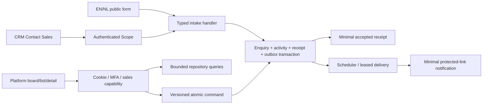

# Phase 4 API and architecture contracts

This document records implemented contracts. Paths below include `/api/v1`. Application source is authoritative when changed later.

## Intake

`POST /api/v1/public/demo-requests` accepts anonymous input. `POST /api/v1/demo-requests/sales-enquiries` uses existing CRM bearer authentication and `get_user_scope`; organization and requester are derived by the server. Authenticated users with organization context can contact sales after subscription expiry. CRM intake produces `source=crm_billing`, `enquiry_type=enterprise_sales`; public intake produces `public_website`, `demo`. Submitted stage, assignee, source and organization fields are rejected.

Both endpoints require a UUID `Idempotency-Key`, and reject streamed bodies over 16 KiB before JSON parsing. Fields:

| Field              | Contract                                                                |
| ------------------ | ----------------------------------------------------------------------- |
| `name`, `company`  | Required, trimmed, nonblank, maximum 200 characters                     |
| `email`            | Required valid email, maximum 254, trimmed/lowercased                   |
| `phone`            | Optional, maximum 40                                                    |
| `team_size`        | Optional: `1-10`, `11-20`, `21-50`, `51-100`, `100+`                    |
| `message`          | Optional plain text, maximum 4,000                                      |
| `preferred_window` | Optional plain-text contact preference, maximum 200; not an appointment |
| `timezone`         | IANA timezone, maximum 80, defaults UTC; qualifies the preferred window |
| `locale`           | `en` or `nl`, defaults `en`                                             |
| `contact_consent`  | Explicit JSON boolean `true`; not marketing consent                     |
| `website`          | Optional honeypot, maximum 200; genuine forms leave empty               |

Accepted intake commits enquiry, creation activity, 24-hour receipt and configured internal notification intents together. Response is `202` with only `reference` and `message`, for example `{"reference":"DEMO-<opaque identifier>","message":"Thank you. Your enquiry has been received."}`. Provider delivery runs later. A populated honeypot returns a neutral receipt without a record. There is no public list/detail/status lookup or customer email acknowledgement.

Same key, normalized payload and trusted context replay the receipt during its window. Changed input/context conflicts with `409`; new keys permit subsequent enquiries. Quotas apply to IP attempts and normalized-email digests, not raw email log keys. Public and CRM form retry state remains in component memory, and uncertain retries reuse identical input/key. Drafts never enter URL state or localStorage. Public analytics excludes demo and protected routes; the form is marked private and supplies no data to public AI.

## Sales authorization

Staff credentials hold JSON `capabilities` (non-null, default empty) and positive `capability_revision` (default 1). `demo.manage` implies `demo.read`; owner has both implicitly. CRM roles, bearer tokens and the historical super-admin flag do not supply these grants. Existing/new invited staff have no sales access by default.

Owner-only `POST /api/v1/superadmin/auth/staff/{id}/sales-capabilities` accepts `expected_version` and `capabilities` containing sales literals, with UUID `Idempotency-Key`, normal platform cookie/origin/custom-header/CSRF requirements. It preserves unrelated future grants. Effective changes increment credential version/revision and append a platform security event in the same command transaction. Owner implicit grants cannot be edited here.

All reads retain platform authentication/MFA eligibility and require `demo.read`; writes additionally require `demo.manage` and CSRF. Commands revalidate current identity and grants under the existing PostgreSQL platform security lock before replaying a command receipt. The same lock serializes owner grant changes and assignment eligibility checks. Revoked access cannot reuse a previously successful receipt.

Identity refreshes on focus and every 30 seconds. Query keys contain principal, session epoch, capability revision and response-affecting view parameters. Revision changes cancel/remove previous-scope data; 403 responses clear privileged queries and refresh identity. Backend checks remain authoritative during the polling interval.

## Reads

| Endpoint                                 | Behavior                                                                                         |
| ---------------------------------------- | ------------------------------------------------------------------------------------------------ |
| `GET /api/v1/superadmin/demo-requests`   | Bounded list or a stage cursor page                                                              |
| `GET .../counts`                         | Every fixed stage, including zero; same filters except stage/pagination                          |
| `GET .../assignees`                      | Minimal ID/name projection of active, MFA-eligible managing staff; read access allows filter use |
| `GET .../{id}`                           | Contact/detail and related-email enquiry count; notification IDs/statuses only for managers      |
| `GET .../{id}/history`, `.../{id}/notes` | Independent newest-first, timestamp/ID-ordered pages                                             |

Shared filters: escaped literal search over name/company/email (maximum 200), stage, `normal`/`spam` disposition, assignee UUID or unassigned, enquiry type, trusted source, aware created-date range. Sorts are `created_at`, `updated_at`, `follow_up_at`, asc/desc, nulls last with UUID tie-breaker. Limit defaults 20, maximum 100; offset maximum 100,000. History defaults 30. Assignees support bounded name search and pagination.

Columns use created-time/UUID cursors with stage and zero offset, initially 20 records each; counts are separate snapshots. A stable dataset with equal timestamps pages without omission/duplication. Updates invalidate affected queries rather than pretending that independently loaded columns are one atomic snapshot. The URL owns normalized view, filters, sorting and list pagination; detail links preserve a safe return query. Search parameters are removed from Uvicorn access logs for this protected endpoint family.

Read-only assignee access is an intentional refinement of the proposed manage-only endpoint: filtering needs eligible staff names without mutation authority. Scheduling fields are absolute aware timestamps plus IANA metadata. Preferred windows remain bounded text plus timezone, rather than pretending that a natural-language preference is a calendar booking.

## Commands and history

Every command requires `expected_version` and UUID operation key. Routes validate/authorize/delegate to focused handlers; repositories own persistence and shared strategies own workflow changes. Entity, activity, note where applicable and replay receipt commit atomically under locks. Conflicts return `409`; no partial history or silent overwrite. A replay precedes stale-version rejection but follows current authorization.

| POST suffix on `.../{id}` | Additional fields/rules                                                                      |
| ------------------------- | -------------------------------------------------------------------------------------------- |
| `/stage`                  | `stage`, optional schedule/timezone/reason; rules below                                      |
| `/assignment`             | Required nullable `assignee_id`; non-null must currently be eligible                         |
| `/schedule`               | Future aware `scheduled_at`, valid `timezone`; does not force a stage change                 |
| `/follow-up`              | Nullable aware `follow_up_at`, `timezone` default UTC; past dates intentionally show overdue |
| `/disposition`            | `normal`/`spam`, nonblank reason                                                             |
| `/notes`                  | Trimmed, nonblank plain-text `body`, maximum 4,000; parent version increments                |

Normal progression is `new → contacted → qualified → demo_scheduled → demo_completed → follow_up → converted`, with `not_proceeding` as a terminal alternative. Skip/backward moves and terminal outcomes require a reason, maximum 1,000. Entering scheduled requires a future schedule supplied atomically or already stored. Terminal records reopen only to contacted with reason. Same-stage commands validate authorization/version but create no new activity. Spam blocks operational changes until restored with reason and is excluded by default. Deactivated assignees remain visible with an eligibility warning; no automatic reassignment occurs.

Activity stores actor/system, action/time, before/after values and optional reason. Notes are separately append-only; note activity stores only its ID rather than duplicate note text. UTC timestamps and IANA metadata distinguish preferred contact, scheduled demo and follow-up. No calendar send, automatic organization creation or subscription mutation occurs.

Errors use safe platform envelopes and no-store responses: `401` unauthenticated/expired, `403` denied/origin/CSRF, `404` missing, `409` replay/version/workflow conflict, `413` size, `422` invalid input/filter/cursor/prerequisite, `429` admission and `503` unavailable protection/persistence. Validation errors omit raw submitted values.

