# Crusource Superadmin — User-Facing Data Flows

**Status:** Draft for designer review  
**Audience:** Product owner and UI/UX designer  
**Companion:** [Product requirements](SUPERADMIN_PRD.md)  
**Scope:** First release of the unified Crusource Superadmin portal for CRM and VMS

---

## Contents

1. [How to read this document](#1-how-to-read-this-document)
2. [Vocabulary](#2-vocabulary)
3. [Who and what is involved](#3-who-and-what-is-involved)
4. [Main information flow](#4-main-information-flow)
5. [Topbar product switcher flow](#5-topbar-product-switcher-flow)
6. [Sign-in, session, and internal staff access](#6-sign-in-session-and-internal-staff-access)
7. [Overview flow](#7-overview-flow)
8. [Organization and customer-user discovery](#8-organization-and-customer-user-discovery)
9. [Confirming shared customers and users](#9-confirming-shared-customers-and-users)
10. [Common billing flow](#10-common-billing-flow)
11. [Requests and feedback flow](#11-requests-and-feedback-flow)
12. [Administrative action flow](#12-administrative-action-flow)
13. [Support access flow](#13-support-access-flow)
14. [Activity and security flow](#14-activity-and-security-flow)
15. [Product operations flow](#15-product-operations-flow)
16. [Export flow](#16-export-flow)
17. [Unavailable information and recovery](#17-unavailable-information-and-recovery)
18. [Conflicts, expiry, and interruptions](#18-conflicts-expiry-and-interruptions)
19. [Role and action summary](#19-role-and-action-summary)
20. [Designer handoff checklist](#20-designer-handoff-checklist)

---

## 1. How to read this document

This document explains, step by step, **what Crusource staff choose, what information is shown or changed, and what they see next**. It is written for people designing the experience, not for people building the infrastructure. It intentionally avoids database, API, and service details.

Each flow section follows the same structure:

| Part                     | What it tells the designer                                              |
| ------------------------ | ----------------------------------------------------------------------- |
| **Purpose**              | Why staff use this flow.                                                |
| **Starting point**       | Where in the portal the flow begins.                                    |
| **Diagram**              | The sequence of choices, decisions, and outcomes.                       |
| **Step-by-step**         | A narrative description of each stage.                                  |
| **Information involved** | What staff see, what they enter, and what changes as a result.          |
| **Rules and edge cases** | Behaviour that must be preserved, including failures and restrictions.  |
| **Screens to design**    | The views and states the designer should produce for this flow.         |

**Reading the diagrams**

- Rectangles are screens or steps the staff member experiences.
- Diamonds are decisions — either a staff choice or a condition the portal checks.
- Labelled arrows show which path is taken for each outcome.
- Every diagram describes the **desired** experience. These flows are requirements, not claims that the current CRM or VMS applications already support them.

Recommended defaults (for example, CRM as the first-time platform) match the PRD and can be revised during product review. Portal sign-in uses email and password only, without MFA.

---

## 2. Vocabulary

| Term                         | Meaning in this document                                                                                                          |
| ---------------------------- | --------------------------------------------------------------------------------------------------------------------------------- |
| **Crusource**                | The product and portal name.                                                                                                      |
| **Platform**                 | Either **CRM** or **VMS**. There is no “All Products” option.                                                                     |
| **Selected platform**        | The platform currently chosen in the topbar switcher. Platform screens show information for this platform only.                   |
| **Platform screen**          | A screen whose content depends on the selected platform: Overview, Organizations, Users, Requests & Feedback, Activity & Security, Product Operations. |
| **Shared screen**            | A screen whose content does not change with the switcher: **Billing** and **Staff & Access**. Labelled “Shared across CRM and VMS”. |
| **Staff**                    | Internal Crusource employees who use this portal (Super Admin or Sub Admin).                                                      |
| **Customer**                 | An organization or person using CRM, VMS, or both. Customers never use this portal.                                               |
| **Combined profile**         | One confirmed organization or person, shown once, with separate CRM and VMS platform memberships.                                 |
| **Platform membership**      | A customer's presence in one platform: its role, access status, member count, subscription state, and activity in that platform.  |
| **Administrative activity**  | The recorded history of what staff did: who, which platform, which customer, what action, result, time, and reason.              |
| **Stale information**        | The last successfully loaded information, shown with its timestamp because a fresh update is currently unavailable.              |

---

## 3. Who and what is involved

### 3.1 People

| Person                | Role in these flows                                                                                                            |
| --------------------- | ------------------------------------------------------------------------------------------------------------------------------ |
| **Super Admin**       | The first designated owner of the portal. Can perform every product and billing action and manages Sub Admin access.          |
| **Sub Admin**         | Internal staff, including developers. Sees both platforms; administers organizations and users, handles requests, troubleshoots. |
| **Invited staff**     | A person who has received a Sub Admin invitation but has not yet activated it.                                                 |
| **Customer (indirect)** | Organizations and users whose information is shown. They do not interact with this portal but are affected by staff actions. |

### 3.2 Information areas

These are the conceptual groups of information the portal reads from or changes. They are **not** a technical design.

| Information area               | Contents (as seen by staff)                                                                   | Changes with switcher? |
| ------------------------------ | --------------------------------------------------------------------------------------------- | ---------------------- |
| **CRM platform information**   | CRM organizations, users, memberships, requests, login history, availability, feature settings | Yes — shown when CRM is selected |
| **VMS platform information**   | The same categories for VMS                                                                   | Yes — shown when VMS is selected |
| **Common billing information** | Organization billing profiles, CRM/VMS subscription items, invoices, payments, trials, renewals | No                     |
| **Internal staff access**      | Staff directory, roles, permission profiles, invitations, access status                                           | No                     |
| **Confirmed customer links**   | Which CRM and VMS records were confirmed as the same organization or person                  | No                     |
| **Administrative activity**    | History of staff actions, labelled by platform or “Shared”                                   | Platform-specific entries change; shared entries are labelled |
| **Staff preferences**          | The last selected platform for each staff member                                              | Updated by the switcher |

### 3.3 Context diagram

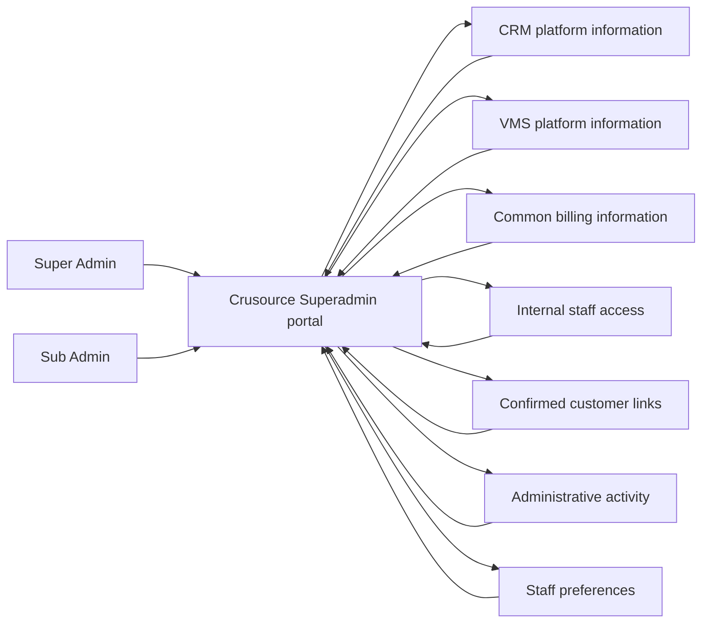

**What this shows:** staff only ever interact with the portal. The portal reads from and writes to separate information areas. CRM and VMS information remain separate; billing, staff access, customer links, and staff preferences are shared.

---

## 4. Main information flow

**Purpose:** give staff a single, predictable place to manage both platforms.

**Starting point:** a successful sign-in.

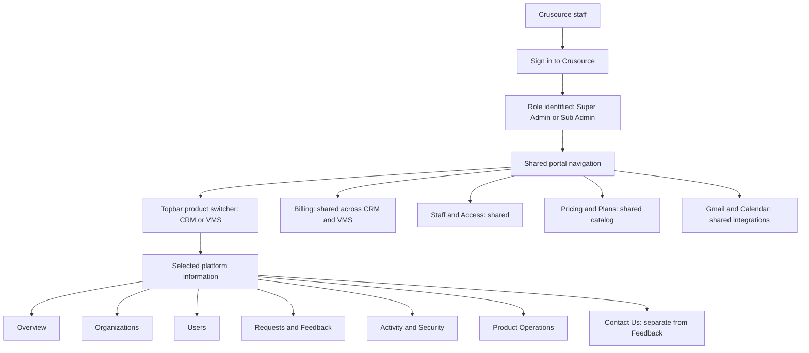

### Step-by-step

1. Staff sign in once with their internal account. The same account serves both platforms.
2. The portal identifies the staff role. The role and assigned permission profile control **which actions** are allowed, never **which platform** is visible.
3. The navigation menu appears in a fixed order, identical for CRM and VMS:
   Overview → Organizations → Users → Billing → Requests & Feedback → Activity & Security → Product Operations → Staff & Access.
4. The topbar switcher shows the selected platform at all times.
5. Platform screens display information for the selected platform only.
6. Billing, Pricing & Plans, Staff & Access, and Integrations display the same shared information regardless of the switcher.

### Information involved

- **Shown:** the staff member's name and role, the selected platform, the navigation menu, and the content of the chosen screen.
- **Changed:** nothing, until staff take an action or switch platform.

### Rules

- The menu template, item order, and screen layouts are identical for CRM and VMS.
- Shared screens carry a visible “Shared across CRM and VMS” label.
- No screen combines CRM and VMS counts into a single total that could be read as unique customers or people.

### Screens to design

- Signed-in shell: topbar with switcher, search, and staff profile; side navigation.
- The shell with CRM selected and with VMS selected, demonstrating that only the data changes.

---

## 5. Topbar product switcher flow

**Purpose:** let staff move between CRM and VMS without losing their place.

**Starting point:** any signed-in screen.

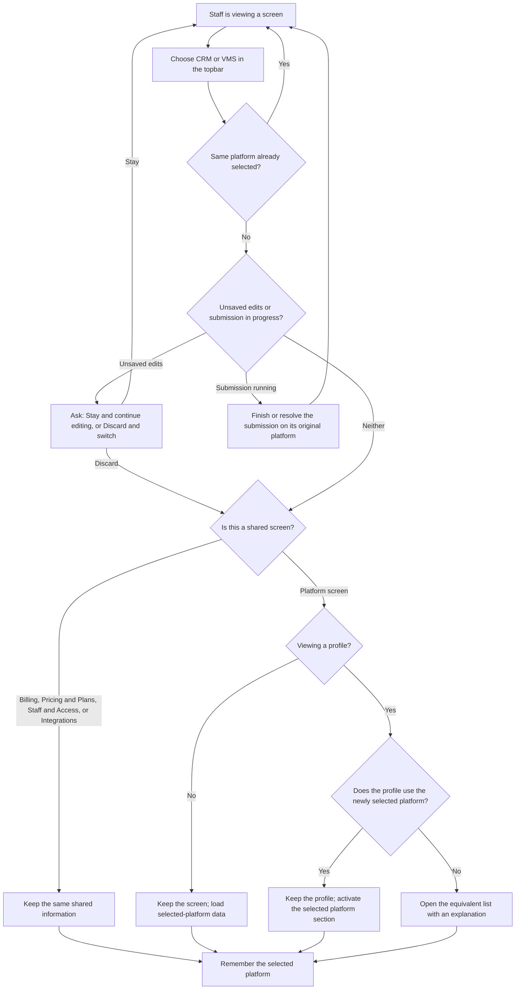

### Step-by-step

1. **Choice.** Staff select the other platform in the topbar. The selected label updates immediately so staff always know which platform they are looking at.
2. **Protect work in progress.**
   - If a form has unsaved edits, staff choose **Stay and continue editing** or **Discard and switch**. Edits are never silently lost.
   - If a change is being submitted, the switch waits until the submission completes or fails. The submission always targets the platform that was selected when it started.
3. **Decide what to show.**
   - **Shared screen:** content remains the same. Only the remembered platform changes.
   - **Platform list or summary screen:** the same screen loads the newly selected platform's information.
   - **Profile that uses both platforms:** the same profile stays open; the newly selected platform section becomes active.
   - **Profile that does not use the new platform:** staff are taken to the equivalent list for the new platform with the message *“This organization does not use VMS”* (or CRM, or “This user…”).
4. **Remember.** The selection is saved and restored at the next sign-in.

### Information involved

- **Shown during loading:** the new platform label and loading placeholders. Values from the previous platform are cleared immediately and are never displayed under the new platform's label.
- **Changed:** the staff member's remembered platform.

### Search, filters, sorting, and pagination

| Item                                    | Behaviour after switching                            |
| --------------------------------------- | ---------------------------------------------------- |
| Search text                             | Kept.                                                |
| Filter that exists in both platforms    | Kept.                                                |
| Filter that exists only in the old platform | Cleared, with a short explanation.               |
| Sorting                                 | Kept when valid in the new platform; otherwise reset to the default. |
| Pagination                              | Always returns to the first page.                    |

### Examples

| Before                       | Staff choice | After                                                                  |
| ---------------------------- | ------------ | ---------------------------------------------------------------------- |
| CRM Overview                 | VMS          | VMS Overview; same metric labels and positions                         |
| CRM Organizations            | VMS          | VMS Organizations; same list template                                  |
| CRM Users                    | VMS          | VMS Users; same list template                                          |
| CRM Requests & Feedback      | VMS          | VMS Requests & Feedback; same filters where valid                      |
| Organization using both      | VMS          | Same organization profile; VMS section active                          |
| Organization using only CRM  | VMS          | VMS Organizations list; message explains the customer does not use VMS |
| Common Billing               | VMS          | Same billing information; VMS becomes the remembered platform          |
| Staff & Access               | VMS          | Same staff directory; VMS becomes the remembered platform              |

### Screens to design

- Switcher in its default, hover/focus, and selected states.
- The same screen before and after switching.
- Unsaved-edits confirmation.
- “Submission in progress” waiting state.
- Unsupported-profile redirect with its explanation message.
- Cleared-filter explanation.

---

## 6. Sign-in, session, and internal staff access

### 6.1 Sign-in

**Purpose:** give staff secure access to one portal for both platforms.

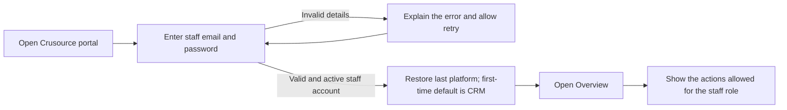

**Step-by-step**

1. Staff open the portal and enter their internal account details.
2. Invalid details produce a clear, non-revealing error and allow another attempt.
3. An active internal account with valid email/password is signed in directly. No MFA or second verification screen is included.
4. The portal restores the last selected platform; first-time staff start on CRM.
5. Staff land on Overview with the actions permitted for their role.

**Rules**

- Staff accounts and customer accounts are visibly separate; a customer login is never accepted here.
- Both roles see both switcher options.
- Sessions expire after a period of inactivity. Expiry returns staff to sign-in without completing any pending unauthorized action (see [section 18](#18-conflicts-expiry-and-interruptions)).
- Sign-out is always available from the staff profile menu.

### 6.2 Staff invitation and lifecycle

**Purpose:** let the Super Admin control who can access the portal.

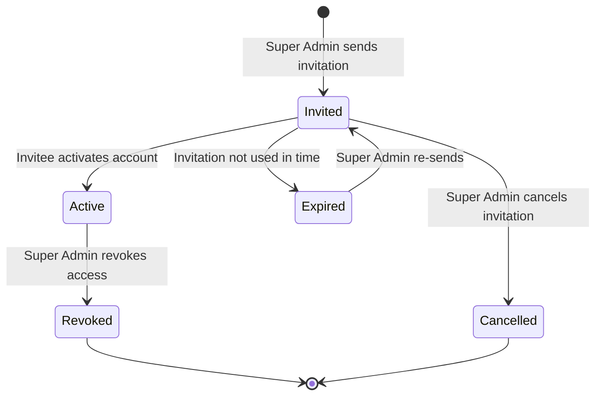

**Step-by-step**

1. The Super Admin opens **Staff & Access** and chooses **Invite Sub Admin**.
2. The Super Admin enters the staff member's name and email address, assigns a permission profile, and confirms.
3. The invitation appears in the directory as **Pending**.
4. The invitee follows the invitation, sets their password, and activates the account. Subsequent sign-ins use email and password only.
5. The status changes to **Active**. The new Sub Admin can now see both platforms.
6. Revoking access ends portal access for **both** platforms immediately and is recorded in shared staff-access history.

**Rules**

- Only the Super Admin can invite, cancel, re-send, or revoke.
- A Sub Admin cannot change or remove the Super Admin account.
- Customer membership changes never grant internal portal access.

**Screens to design:** email/password sign-in, forgot/reset password, error states, staff directory, invitation form, pending/active/expired/revoked statuses, revoke confirmation.

---

## 7. Overview flow

**Purpose:** give staff a quick, trustworthy summary of the selected platform and point them to what needs attention.

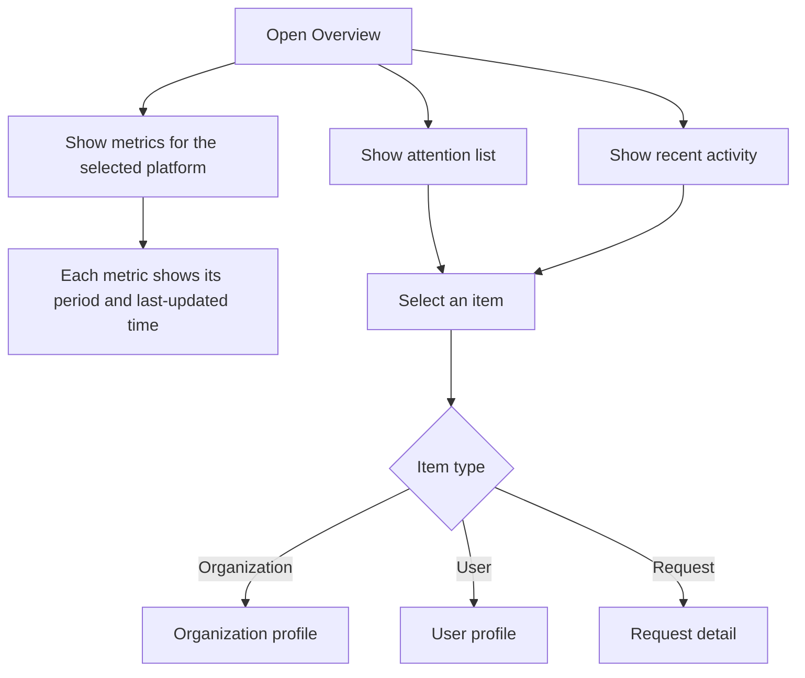

### Metrics (same labels and positions for CRM and VMS)

| Metric                                  | Recommended definition                                         |
| --------------------------------------- | -------------------------------------------------------------- |
| Total and active organizations          | Active = enabled for the selected platform                     |
| Total and active customer accounts      | Active = signed in within the last 30 days                     |
| New organizations (last 30 days)        | Organizations added to the selected platform in the period     |
| New customer accounts (last 30 days)    | Accounts added to the selected platform in the period          |
| Trials ending within seven days         | Selected-platform trials ending in the next seven days         |
| Pending requests, by type               | Unresolved feedback, demo requests, and trial extensions awaiting a decision |

### Rules

- Show administrative summaries only. Do not display deals, candidate records, documents, or other customer business content.
- Billing totals live on the Billing screen, not on Overview.
- If a metric cannot be loaded, show “Unavailable”, never zero.

### Screens to design

Overview for CRM and VMS, loading placeholders, unavailable metric, stale metrics, empty attention list.

---

## 8. Organization and customer-user discovery

**Purpose:** let staff find a customer organization or person and understand their status in the selected platform.

**Starting point:** Organizations or Users in the navigation.

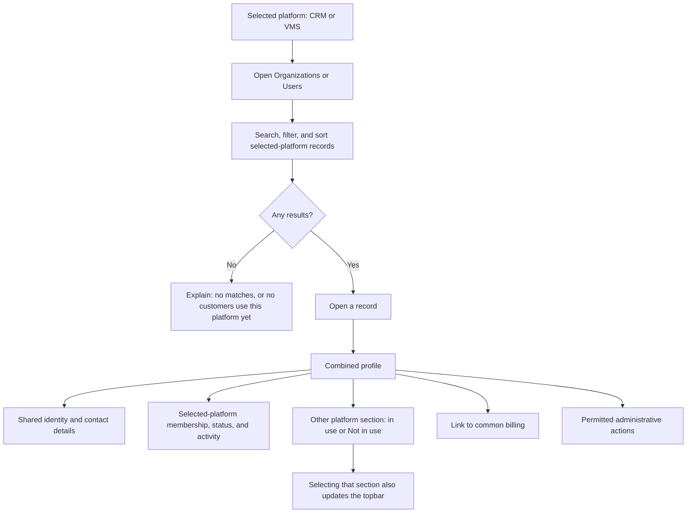

### Step-by-step

1. Staff open **Organizations** or **Users**. Only customers using the selected platform appear.
2. Staff search and filter. Each row shows enough to decide whether to open it:
   - **Organizations:** name, product badges, account status, owner/contact, member count.
   - **Users:** name, organization, membership role, status, last activity.
3. Staff open a record to see its **combined profile**.
4. The profile header shows shared details: name, customer reference, primary contact, CRM/VMS usage badges, and a link to common billing.
5. The profile body uses the same tabs in both platforms: **Summary, Members, Requests, Activity**.
6. The selected platform's section is active. The other platform's section shows its own data, or **“Not in use”** if the customer does not use it. “Not in use” is not an error.
7. Selecting the other platform's section updates the topbar switcher to match.

### Rules

- A combined profile does **not** mean roles, access, member counts, subscriptions, or suspension status are identical across platforms. Each platform membership is shown and managed separately.
- For a combined user profile, each membership shows its organization, role, access status, and activity. Removing CRM access does not remove VMS access.
- Provisioning the other platform is a separate, explicit action (see [section 15](#15-product-operations-flow)).

### Screens to design

Organization list, user list, filter panel, empty results, organization profile (both platforms in use, one platform in use), combined user profile with two memberships.

---

## 9. Confirming shared customers and users

**Purpose:** combine CRM and VMS records only when they genuinely belong to the same organization or person.

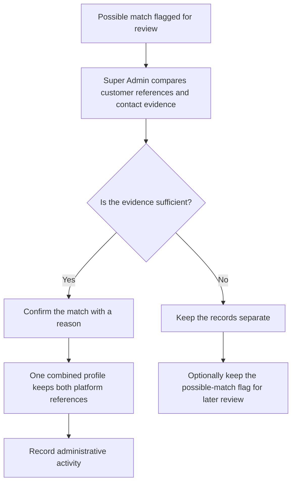

### Rules

- Similar names alone never establish a match.
- Organizations: the Super Admin confirms the link. Each platform's original customer reference is preserved.
- Users: records are combined only when a shared verified identity is confirmed. Otherwise they remain separate profiles with a possible-match flag.
- Linking does not merge roles, access, subscriptions, or billing; it only presents them together.

### Screens to design

Possible-match list, side-by-side comparison, confirmation with reason, “kept separate” outcome.

---

## 10. Common billing flow

**Purpose:** let staff review and manage billing for both platforms in one place.

**Starting point:** Billing in the navigation, or the billing link on an organization profile.

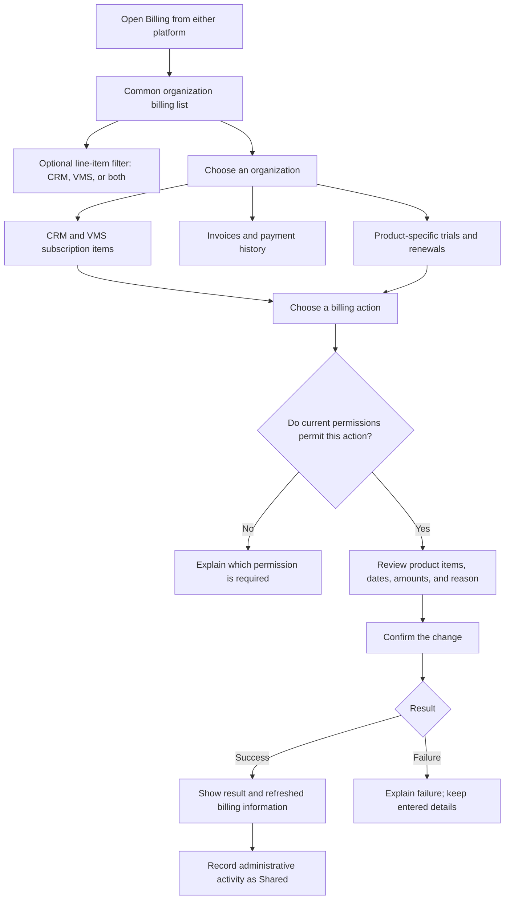

### Step-by-step

1. Staff open Billing. The topbar switcher does **not** change these results.
2. A separate, optional line-item filter can narrow results to CRM or VMS items.
3. Staff open an organization's billing profile, which shows:
   - Separate CRM and VMS subscription items, each with its own plan, status, trial, and renewal date.
   - Invoices and payment history. Existing separate invoices are shown with their original product and reference. Grouped invoices, where supported, keep distinct product line items.
4. Staff choose an action, review exactly what will change, enter a reason, and confirm.
5. The new amounts, dates, or plans appear only after a successful result is confirmed.

### Billing actions and recommended role defaults

| Action                     | Super Admin | Sub Admin |
| -------------------------- | ----------- | --------- |
| Inspect billing            | Yes         | Yes       |
| Extend a trial             | Yes         | Yes       |
| Change a plan              | Yes         | No        |
| Apply a discount           | Yes         | No        |
| Issue a refund             | Yes         | No        |
| Change a renewal           | Yes         | No        |

### Rules

- Common billing does not imply a single combined plan, shared renewal date, or shared trial.
- If one platform's billing information is incomplete, identify the missing portion and do not present totals as complete.

### Screens to design

Billing list, line-item filter, organization billing profile, invoice detail, action review, confirmation, success, failure, restricted action.

---

## 11. Requests and feedback flow

**Purpose:** let staff handle customer feedback, demo requests, and trial-extension requests for the selected platform.

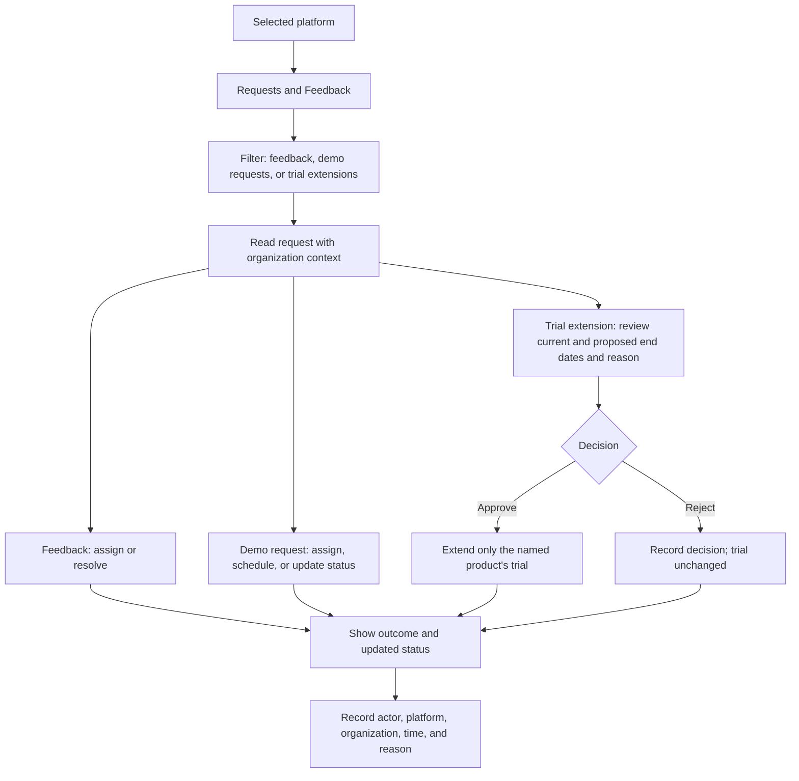

### Step-by-step

1. Staff open **Requests & Feedback** and filter by request type, status, or assignee.
2. Opening a request shows its content together with the organization's name, platform, and status.
3. Staff take the appropriate action:
   - **Feedback:** assign to a staff member or mark as resolved.
   - **Demo request:** assign, schedule, add notes, or move between workflow stages.
   - **Trial extension:** compare the current and proposed end dates, read the reason, then approve or reject.
4. The outcome and updated status appear only after the action succeeds.

### Rules

- Approval changes only the named product's trial for the named organization.
- Rejection records the decision without changing the trial.
- Each action keeps the platform and organization that were displayed when it began, even if staff switch platform before it completes.
- If another staff member already decided the request, show the current decision and ask staff to review (see [section 18](#18-conflicts-expiry-and-interruptions)).

### Screens to design

Request list with filters, feedback detail, demo request detail, trial-extension review, approve/reject confirmation, already-decided state.

---

## 12. Administrative action flow

**Purpose:** make every change to a customer safe, explicit, and traceable.

**Applies to:** suspension and reactivation, customer membership changes, provisioning, and feature settings.

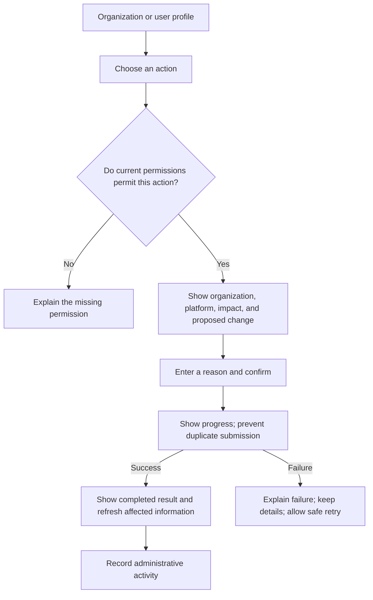

### Step-by-step

1. Staff choose an action from a profile.
2. If the current permission profile does not permit it, the action explains which permission is required instead of silently disappearing.
3. A review step states exactly **which organization or user**, **which platform**, **what will change**, and **the expected impact**.
4. Staff enter a reason and confirm.
5. The portal shows progress and blocks duplicate submissions.
6. On success, the result is confirmed and affected information refreshes. On failure, the explanation appears and entered details are kept for a safe retry.

### Rules

- Never show success before the action completes.
- Suspending CRM access does not suspend VMS access or cancel any subscription.
- Provisioning a platform has its own explicit result; adding a badge alone is not provisioning.
- Sub Admins may change customer memberships but can never grant internal portal access.

### Screens to design

Action menu, restricted action, review/confirmation with reason, in-progress state, success, failure with retry.

---

## 13. Support access flow

**Purpose:** let permitted staff view a customer's experience to troubleshoot, under strict safeguards.

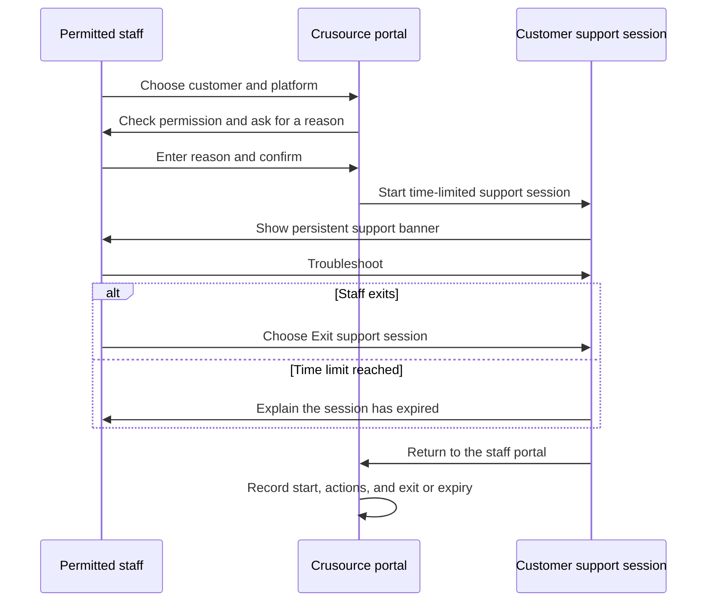

### Rules

- A support session is never presented as an ordinary customer login.
- The banner remains visible throughout and always offers **Exit**.
- The session ends automatically when the time limit is reached.
- Start, actions taken, and exit or expiry are all recorded.

### Screens to design

Start-support confirmation, active support banner, expiry notice, return to portal.

---

## 14. Activity and security flow

**Purpose:** let staff investigate customer sign-ins and staff actions.

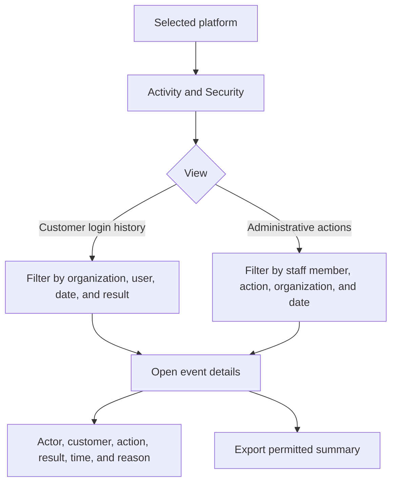

### Where activity appears

| Activity type                     | Where it is shown                                   |
| --------------------------------- | --------------------------------------------------- |
| Platform-specific actions         | Activity & Security for that platform               |
| Billing actions                   | The organization's billing profile, labelled Shared |
| Staff access changes              | Staff & Access history, labelled Shared             |
| Shared events shown in a platform view | Labelled “Shared”, never presented as platform-specific |

### Rules

- Times show their time context wherever they affect an audit event.
- Event details are read-only.

### Screens to design

Login history list, administrative activity list, filters, event detail, empty results.

---

## 15. Product operations flow

**Purpose:** let staff check platform availability and manage feature settings and provisioning.

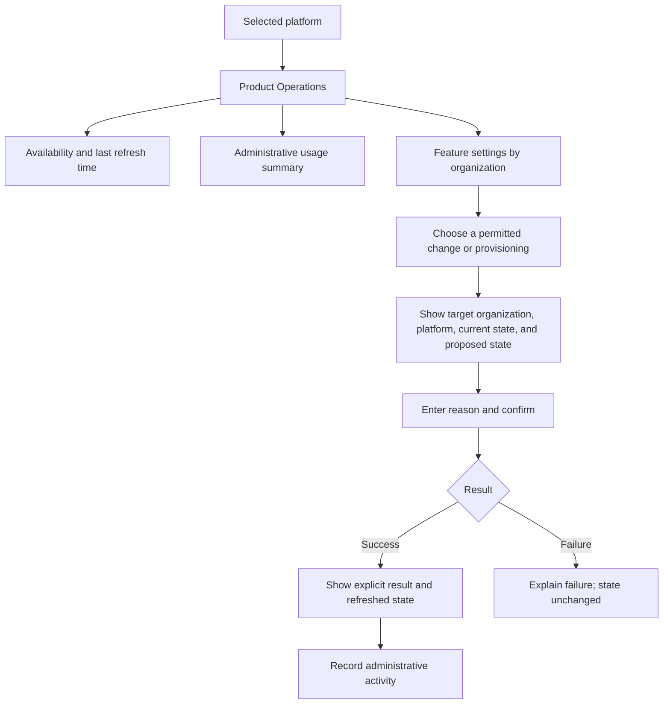

### Rules

- Availability reports service status; it does not promise every customer workflow is functioning.
- Enabling the other platform for an organization requires a provisioning result, not just a badge change.

### Screens to design

Availability summary, usage summary, feature settings list, change review, provisioning result.

---

## 16. Export flow

**Purpose:** let staff take permitted information out of the portal in a clearly labelled form.

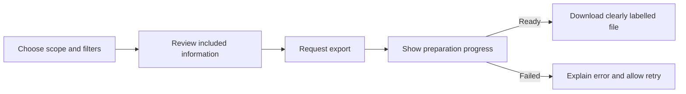

### Rules

- Export only information permitted by both viewing and export permissions in the current staff profile.
- Label each file with its platform (or “Shared” for billing) and export time.
- The export reflects the scope and filters that were reviewed.

---

## 17. Unavailable information and recovery

**Purpose:** keep staff informed and safe when information cannot be loaded.

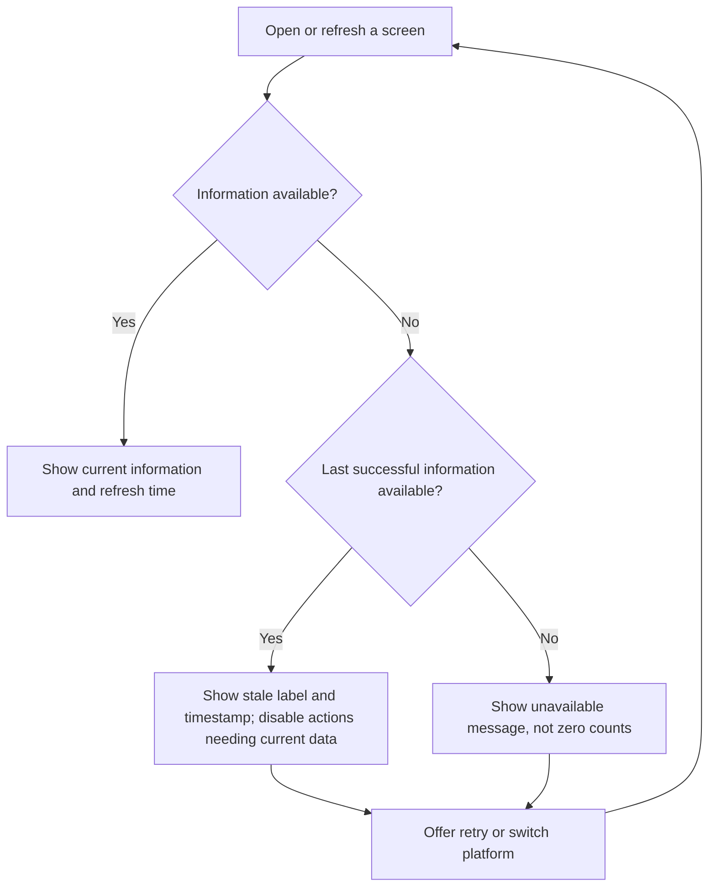

### Rules

- A CRM problem does not block VMS, and a VMS problem does not block CRM.
- Shared Billing, Pricing & Plans, Staff & Access, and Integrations remain usable whenever their own information is available.
- If shared billing has incomplete product information, identify the missing portion and do not present totals as complete.

### States to design

| State                  | Expected experience                                                               |
| ---------------------- | --------------------------------------------------------------------------------- |
| Loading                | Selected platform stays visible; placeholders instead of misleading values         |
| No results             | “No organizations use VMS yet” or “No results match these filters” with clear-filter option |
| Platform unavailable   | Unavailable status and retry; other platform and shared screens remain usable      |
| Stale                  | Last successful update time and a stale label                                     |
| Restricted             | Actions explain the required role                                                 |
| Successful change      | Organization, platform, and completed action confirmed                            |
| Failed change          | Failure explained; entered information kept                                       |

---

## 18. Conflicts, expiry, and interruptions

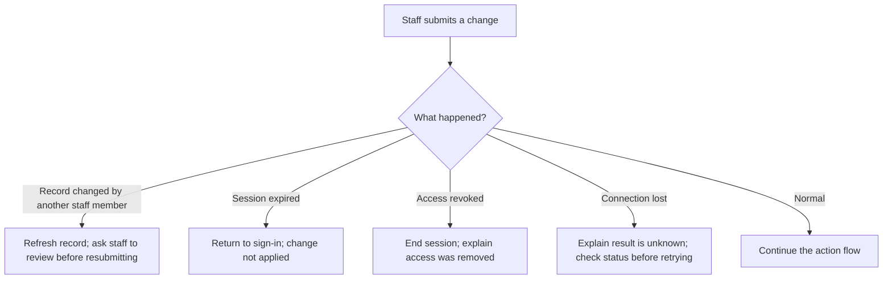

### Rules

- A change is never applied after session expiry or access revocation.
- When the result is unknown, staff check the current state before retrying, to avoid duplicate changes.
- After signing in again, staff return to the same screen where practical, with the remembered platform.

---

## 19. Role and action summary

Starting defaults, configurable through Sub Admin permission profiles. Internal access and connection management remain Super Admin-only; both products stay visible to everyone.

| Area                         | Action                                  | Super Admin | Sub Admin |
| ---------------------------- | --------------------------------------- | ----------- | --------- |
| Navigation                   | See CRM and VMS                         | Yes         | Yes       |
| Organizations and users      | Search and view profiles                | Yes         | Yes       |
| Organizations and users      | Change customer memberships             | Yes         | Yes       |
| Organizations and users      | Suspend or reactivate                   | Yes         | No        |
| Organizations and users      | Confirm shared customer links           | Yes         | No        |
| Billing                      | Inspect                                 | Yes         | Yes       |
| Billing                      | Extend trials                           | Yes         | Yes       |
| Billing                      | Plans, discounts, refunds, renewals     | Yes         | No        |
| Requests & Feedback          | Assign, resolve, approve, reject        | Yes         | Yes       |
| Activity & Security          | View and export permitted summaries     | Yes         | Yes       |
| Product Operations           | Inspect status                          | Yes         | Yes       |
| Product Operations           | Feature changes and provisioning        | Yes         | As permitted |
| Support access               | Start a support session                 | Yes         | As permitted |
| Staff & Access               | Invite, cancel, re-send, revoke         | Yes         | No        |
| Staff & Access               | Change the Super Admin account          | —           | No        |

No second-person approval is required in the first release; sensitive actions still require confirmation and a reason.

---

## 20. Designer handoff checklist

- [ ] Show the CRM/VMS switcher prominently in the topbar on every signed-in screen, with no “All Products” option.
- [ ] Demonstrate the same screen before and after a platform switch.
- [ ] Show the unsaved-edits confirmation and the submission-in-progress state.
- [ ] Show the unsupported-profile redirect and its explanation.
- [ ] Show Billing, Pricing & Plans, Staff & Access, and Integrations as shared and unchanged by the switcher.
- [ ] Show shared staff access separately from customer users.
- [ ] Show combined organization and user profiles with separate platform memberships and “Not in use” sections.
- [ ] Show the shared-customer confirmation flow.
- [ ] Show the trial-extension review with current and proposed end dates.
- [ ] Include confirmations with reasons, role restrictions, loading, empty, stale, unavailable, success, and failure states.
- [ ] Show the support-session banner, exit, and expiry.
- [ ] Show conflict, session-expired, and access-revoked outcomes.
- [ ] Show how staff return from a detail, action, or support session.
- [ ] Keep diagrams and screen annotations understandable without technical infrastructure knowledge.
- [ ] Show plan editing, revision preview, publication, archiving, and the effect on new versus existing subscriptions.
- [ ] Show Contact Us separately from Feedback, including unassigned-platform inquiries.
- [ ] Show staff personal profiles separately from permission-profile editing and assignment.
- [ ] Show email/password sign-in and recovery without MFA screens.
- [ ] Show connected, partial, expired, and disconnected Gmail/Calendar states.
- [ ] Show Book demo, missing details, unavailable slots, and booked-with-confirmation-pending states.

---

## 21. Dynamic pricing and plan flow

**Starting point:** Pricing & Plans, a shared screen with an independent CRM/VMS catalog filter. Switching the topbar does not change the catalog or an open draft.

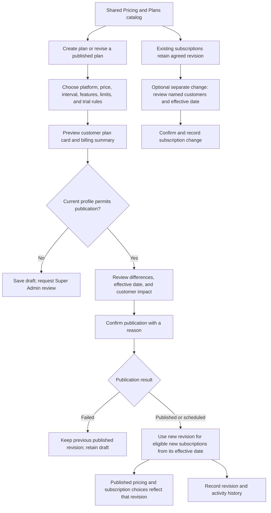

**Information flow:** staff-entered plan → draft → published revision → public pricing/subscription selection → customer's agreed billing item. Drafts never appear as live prices. Billing keeps the customer's agreed revision, not simply the latest catalog price.

Archiving stops new selection without cancelling existing subscriptions. Show current and scheduled revisions clearly. A referenced plan cannot be deleted. Public pricing and billing must not display conflicting revisions after publication.

**Screens:** catalog, plan editor, preview, impact review, publication result, history, archive confirmation, and separate existing-subscription change review.

## 22. Contact Us and Feedback flows

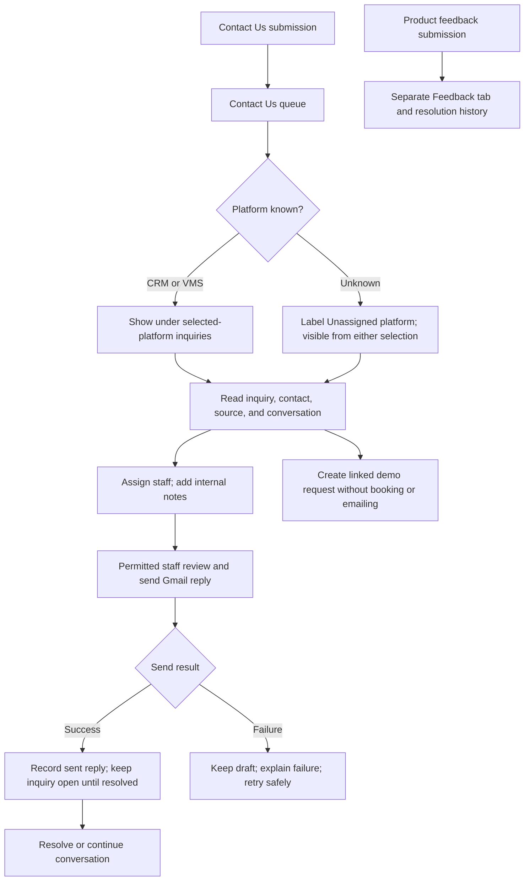

Contact inquiries may come from people without a customer organization; do not invent an organization or discard the message. Classifying an inquiry moves it to the correct platform queue, preserving its history. Feedback does not automatically become a contact inquiry or demo request.

**Screens:** Contact Us list/detail, unassigned queue, assignment, Gmail reply draft/preview, send result, linked demo request, and a separate Feedback list/detail.

## 23. Sub Admin profile and permission flow

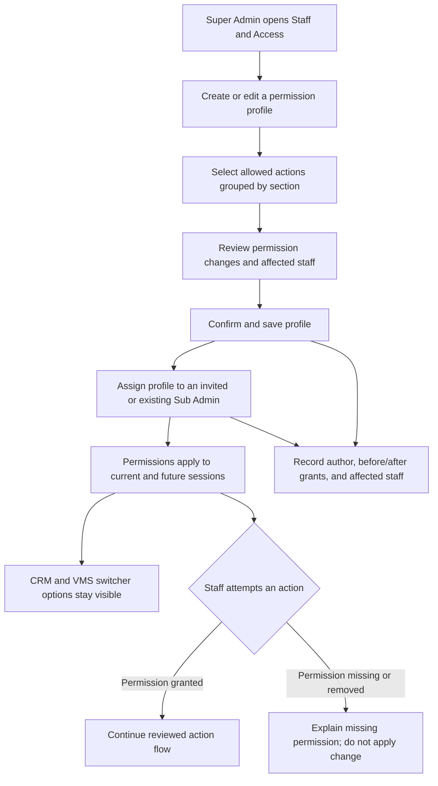

The staff personal profile holds name, email, role, assigned permission profile, and access status. The reusable permission profile holds action grants. They are different screens and concepts. Developer, Support, and Billing are editable profile suggestions under the **Sub Admin** role, not additional roles.

Only Super Admin manages invitations, permission profiles, access revocation, and shared Google connections. Profiles cannot promote a Sub Admin to ownership or allow self-escalation. Changing customer memberships never grants portal access. Check current grants when an action is submitted, including after a profile change.

**Screens:** staff detail, profile list/editor, grouped permission controls, affected-staff preview, profile assignment, history, and restricted-action explanation.

## 24. Gmail and Google Calendar connection flow

```mermaid
flowchart LR
    Owner["Super Admin"] --> Setup["Shared Integrations screen"]
    Setup --> Authorize["Authorize Crusource work account with Google"]
    Authorize --> Gmail["Gmail connection status"]
    Authorize --> Calendar["Calendar connection status"]
    Gmail --> Defaults["Set sender, calendar, duration, location, and confirmation template"]
    Calendar --> Defaults
    Defaults --> Preview["Preview and save booking defaults"]
    Preview --> Use["Permitted staff reply and book through the portal"]
    Use --> Expired["If access expires: show Reconnect required"]
    Expired --> Setup
```

**Boundary between services:** staff sign in to Crusource with email/password. Separately, Super Admin authorizes Google to let Crusource use the selected mail/calendar services. This connection does not enable Google login or add MFA to the portal.

Only the message recipients/content and booking attendee/time/location information needed for a permitted action cross into the connected services. Contacts and attendee information are private; display connection status and account identity, never connection credentials. General inbox browsing is outside this flow.

Gmail and Calendar have separate status indicators. If either is unavailable, explain which actions are blocked. Disconnecting does not cancel existing meetings or remove sent messages.

**Screens:** connection cards, external authorization return, sender/calendar/defaults selection, template preview, partial connection, reconnect, and disconnect-impact confirmation.

## 25. One-click Book demo flow

```mermaid
flowchart TD
    Request["Open demo request"] --> Ready{"Confirmed slot, details, permissions, and both connections ready?"}
    Ready -->|No| Complete["Choose time, complete details, or reconnect"]
    Complete --> Request
    Ready -->|Yes| Book["Click Book demo; visible summary states customer email will be sent"]
    Book --> Check["Check latest availability and existing booking"]
    Check -->|Conflict| Conflict["Choose another time; no success email"]
    Check -->|Already booked| Existing["Open existing booking; do not create a duplicate"]
    Check -->|Available| Event["Create Calendar meeting with configured location or meeting link"]
    Event -->|Creation failed| Fail["Explain failure; do not send booking confirmation"]
    Event -->|Outcome unknown| Verify["Check booking status before any retry"]
    Event -->|Created| Mail["Send one Gmail booking confirmation"]
    Mail -->|Sent| Success["Show Booked, meeting details, and sent confirmation"]
    Mail -->|Failed or uncertain| Pending["Show Booked - confirmation pending"]
    Pending --> Retry["Check message status; retry confirmation only if unsent"]
    Retry --> Mail
    Success --> History["Record organizer, platform, event, and notification result"]
    Pending --> History
```

**One click means:** the request already has an agreed slot and booking defaults, so staff do not fill another scheduling form. Requests missing those details need a review step first.

The request sends booking details to Calendar, then meeting details to Gmail for the customer confirmation. Calendar invitations and Gmail messaging must be coordinated to avoid duplicate confirmations. The request stores the booking reference and notification outcome, so retrying a confirmation never creates another meeting.

Show the customer's time zone and organizer's time context when choosing a slot. A preferred slot is not a confirmed appointment. Rescheduling updates the existing booking; cancellation explicitly cancels it and notifies the customer. Resolving an inquiry or changing a request's stage alone never cancels a meeting.

**Screens:** ready-to-book request, one-click action with booking summary, missing details, slot conflict, progress, booked result, confirmation pending/retry, reschedule, and cancel.
