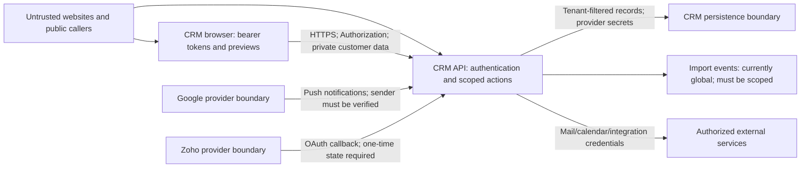

# Crusource CRM security audit

**Date:** 13 October 2026 (Asia/Calcutta)  
**Status:** Pre-remediation audit baseline; local implementation is tracked in the [implementation report](CRM_SECURITY_IMPLEMENTATION_REPORT.md). No deployment performed.  
**Companion:** [Implementation plan](CRM_SECURITY_IMPLEMENTATION_PLAN.md)

## Result and scope

The tester's CORS finding is **confirmed on staging and in source**. The staging/production CORS expression accepts every HTTP(S) origin, even when an explicit origin list is configured. An unrelated origin receives both its own `Access-Control-Allow-Origin` value and `Access-Control-Allow-Credentials: true`.

This review identified **12 distinct remediation items: 6 High and 6 Medium**, with evidence levels distinguished below. These are not 12 successful staging exploits. The dependency item groups several advisories rather than counting every dependency or alias as another application vulnerability.

Reviewed repositories:

- Backend: `crusource-crm-backend`, HEAD `f417b2a717d4c89238230f1c763edd27fc60eafb`.
- Frontend: `crusource-crm-frontend`, HEAD `c834d2dee085cf30d6299b92eb90f730247b95f1`.
- Staging: `https://crm-stage.crusource.com`, limited anonymous GET/OPTIONS checks. The deployed backend/frontend commit identities were not independently established.
- Separate Nx/NestJS VMS repositories are outside this CRM audit.

The review covered CORS/proxy middleware, CRM bearer authentication, platform cookie protections, OAuth, rich HTML/document previews, import events, provider callbacks, registration, credential storage, dependency manifests, and CRM CI/CD definitions. Static inventory found **518 decorated route declarations**; this is an inventory, not a claim that every endpoint received a complete permission review.

Skills applied: Graphify, systematic debugging, API security, secure code review, code security, OWASP Top 10 web, dependency scanning, Playwright, threat modeling, and AWS review discovery. React and web-design guidance informed the frontend observations. Test-driven-development guidance informs the proposed repair sequence; no repaired tests are claimed.

Boundaries: REST/FastAPI/SQLAlchemy backend; Next.js/React frontend; CRM uses browser-held bearer tokens, current database-derived scope/permissions, and organization/record access checks. Internal platform administration separately uses HttpOnly cookies, strict SameSite, origin checks, and CSRF protection. External boundaries include Google, Zoho, AWS storage/email, and Redis. Applicable ASVS areas are V2–V5, V6–V9, and V11–V14.

## Findings register

P0 means first remediation batch; it does not automatically mean CVSS Critical.

| ID          | Severity / priority | Finding                                                                       | Evidence                                                           |
| ----------- | ------------------- | ----------------------------------------------------------------------------- | ------------------------------------------------------------------ |
| CRM-SEC-001 | High / P0           | Arbitrary credentialed CORS origin reflection                                 | Source + staging GET/OPTIONS                                       |
| CRM-SEC-002 | Medium / P0         | Anonymous, unscoped import-event stream                                       | Source + staging anonymous HTTP 200                                |
| CRM-SEC-003 | High / P0           | Untrusted campaign/DOCX HTML rendered without sanitization                    | Source data flow + isolated browser fixtures                       |
| CRM-SEC-004 | High / P0           | Auth callback accepts unsafe redirect destinations and direct tokens          | Source + isolated JavaScript-URL fixture                           |
| CRM-SEC-005 | High / P1           | OAuth exchange URL contains readable long-lived credentials and is replayable | Source-confirmed implementation                                    |
| CRM-SEC-006 | High / P1           | Zoho callback trusts organization ID as OAuth state                           | Source-confirmed; valid configured Zoho code required              |
| CRM-SEC-007 | Medium / P1         | Google webhook callers are not verified                                       | Source-confirmed; connected account/channel required for work      |
| CRM-SEC-008 | Medium / P1         | Registration bypasses verification-email throttling                           | Source-confirmed public route and email dispatch                   |
| CRM-SEC-009 | Medium / P1         | General bearer tokens accepted/transmitted in query strings                   | Source-confirmed download/SSE paths                                |
| CRM-SEC-010 | Medium / P2         | Google/Zoho integration credentials stored as plain application fields        | Source-confirmed; database access needed for theft                 |
| CRM-SEC-011 | High / P0           | Vulnerable backend dependency versions; frontend advisories also present      | pip-audit, npm audit, OSV, EPSS, CISA                              |
| CRM-SEC-012 | Medium / P1         | Login exposes account state before checking the password                      | Source-confirmed; priority includes improving login abuse controls |

## CRM-SEC-001 — Credentialed CORS reflection

- **Final severity:** High. **Status:** Open. **API style:** REST.
- **Mapping:** OWASP A01/A05; API8:2023; CWE-942; ASVS V13/V14.
- **Location:** [main.py](../../crusource-crm-backend/src/main.py), lines 213–226.
- **Evidence:** production/staging uses `else r"^https?://(superadmin\.)?.*$"`, alongside `allow_credentials=True`. The optional `superadmin.` prefix and unrestricted suffix accept every HTTP(S) origin. The regex expands trust beyond `FRONTEND_URL`/`ALLOWED_ORIGINS`.
- **Staging:** OPTIONS and GET with `Origin: https://cors-audit.invalid` returned that origin and credentials permission. `/api/v1/users/me` without authentication still returned **401**. OPTIONS success also occurred for a nonexistent route; preflight success alone is not proof that that route exists.
- **Impact limit:** regular CRM tokens are supplied in Authorization headers or query strings; browsers do not automatically fetch another site's localStorage token. Platform cookies use strict SameSite plus independent origin/CSRF checks. Consequently, the tester's claim of automatic authenticated data theft is **not yet demonstrated**. The configuration is nevertheless unsafe and requires immediate repair. Credential-bearing endpoints must be verified using an authorized test account.
- **Fix:** exact trusted origins in staging/production, reject malformed/wildcard production configuration, and remove the broad production regex. Preserve legitimate platform authentication rather than blindly disabling credentials globally. See the [CORS documentation](https://developer.mozilla.org/en-US/docs/Web/HTTP/Guides/CORS) for credentialed response behavior.
- **Verification:** trusted origins succeed; unrelated domains, lookalike suffixes, `null`, arbitrary subdomains, and wrong scheme/port receive no allowed-origin header on preflight or actual responses.

## CRM-SEC-002 — Public import events and global listeners

- **Severity:** Medium. **Status:** Open. **Mapping:** A01; API1/API4/API5:2023; CWE-862/CWE-200/CWE-400; ASVS V4/V13.
- **Locations:** [data_import_routes.py](../../crusource-crm-backend/src/modules/data_admin/routes/data_import_routes.py), lines 16–46; [sse.py](../../crusource-crm-backend/src/shared/sse.py), lines 5–25; [data_import_handler.py](../../crusource-crm-backend/src/modules/data_admin/handlers/data_import_handler.py), lines 48–50.
- **Evidence:** `/api/v1/admin/data-import/events` has no authentication or import-permission dependency. `subscribe()` adds listeners to one global list; `broadcast()` sends every event to every listener. Published completion events contain entity type and job ID, without an organization-specific channel. Queues and listener counts are unbounded.
- **Staging:** anonymous GET returned HTTP **200**, `Content-Type: text/event-stream`. The connection was closed after inspecting headers; no customer event content was collected.
- **Impact:** unauthorized observation of import activity/job metadata across organizations on the same broadcaster, and a resource-exhaustion surface. This does **not** demonstrate access to imported rows or protected job details. Process-local broadcasting can also miss events when jobs and subscribers run in different workers.
- **Fix/verification:** authorize before streaming; scope publishers and subscribers to organization and permitted job/user; bound subscriptions/queues; check revocation during a stream. Prove anonymous rejection and two-organization isolation using disposable fixtures.

## CRM-SEC-003 — HTML and document preview XSS

- **Severity:** High. **Status:** Open. **Mapping:** A03; API8:2023 for unsafe content processing (the browser sink is primarily a web risk); CWE-79; ASVS V5/V12.
- **Locations:** [CampaignSequencePreview.tsx](../../crusource-crm-frontend/src/components/campaigns/detail/CampaignSequencePreview.tsx), lines 102, 165, 194; [campaign_commands.py](../../crusource-crm-backend/src/modules/campaigns/commands/campaign_commands.py), lines 18/33; [create_campaign_handler.py](../../crusource-crm-backend/src/modules/campaigns/handlers/create_campaign_handler.py), lines 227/258; [documentParsers.ts](../../crusource-crm-frontend/src/lib/parsers/documentParsers.ts), lines 52–72; [DocxViewer.tsx](../../crusource-crm-frontend/src/components/documents/viewers/DocxViewer.tsx), line 124.
- **Evidence:** campaign HTML is accepted as a string, persisted, returned by the detail handler, and inserted directly into the application DOM. DOCX conversion returns Mammoth's HTML unchanged and the viewer inserts it directly. Other campaign and AI preview components use the same raw-HTML pattern.
- **Fixture results:** an image event handler executed in an isolated unsanitized DOM sink. A locally generated DOCX containing a harmless `javascript:` hyperlink was converted by the installed Mammoth package; the link survived and executed a local boolean assignment when clicked. These were fixtures, not authenticated staging campaign/upload tests.
- **Impact:** a malicious contributor/upload can execute code in a viewer's application context when these paths are reached; localStorage-held CRM tokens increase potential impact. DOCX's demonstrated path requires clicking the link. Mammoth explicitly documents that it does not sanitize documents. [Mammoth security guidance](https://github.com/mwilliamson/mammoth.js#security), [OWASP HTML/XSS guidance](https://cheatsheetseries.owasp.org/cheatsheets/Cross_Site_Scripting_Prevention_Cheat_Sheet.html).
- **Fix/verification:** central maintained HTML sanitization and URL-protocol policy at every preview sink, including stored/AI content; optionally isolate document previews without script capability. Preserve allowed email formatting. Test handlers, SVG, dangerous URLs, encoded/malformed markup, and ordinary rich text; add CSP as a secondary measure.

## CRM-SEC-004 — Unsafe auth callback navigation

- **Severity:** High. **Status:** Open. **Mapping:** A03/A07; API2:2023; CWE-79/CWE-601; ASVS V3/V5.
- **Location:** [auth/callback/page.tsx](../../crusource-crm-frontend/src/app/auth/callback/page.tsx), lines 21–29, 58, 81–96.
- **Evidence:** `return_to` is read directly from the query string and supplied to `window.location.assign`. A legacy branch accepts any nonempty `access_token` query value, writes it to localStorage, and reaches the navigation sink without first checking the token. `javascript:` and external URLs are not restricted here.
- **Impact:** crafted callback links enable unsafe navigation, login/session confusion, and a JavaScript-navigation XSS path. A fixture confirmed that `location.assign` with a harmless JavaScript URL executes. No real credentials were read and the live callback was not exploited.
- **Fix/verification:** only same-origin approved relative paths; reject schemes, protocol-relative URLs, control characters, and encoded bypasses. Remove direct-token URL login branches. Test the actual callback route with a mocked exchange and malicious destinations; preserve valid onboarding/dashboard returns.

## CRM-SEC-005 — Exchange code embeds access and refresh tokens

- **Severity:** High. **Status:** Open. **Mapping:** A02/A07; API2:2023; CWE-598/CWE-294; ASVS V3/V8.
- **Locations:** [google_oauth_state.py](../../crusource-crm-backend/src/modules/auth/handlers/google/google_oauth_state.py), lines 102–145; [google_callback_handler.py](../../crusource-crm-backend/src/modules/auth/handlers/google/google_callback_handler.py), lines 241–257 and 365–386.
- **Evidence:** the exchange code is an HS256-signed JWT containing `access_token` and `refresh_token`, inserted into `/auth/callback?code=...`. The exchange handler decodes it and returns the embedded tokens; it does not consume/store/check the `jti` for one-time use.
- **Impact:** a party who obtains the callback URL can read the embedded credentials without knowing the signing key. The outer code's 60-second expiry does not shorten the embedded refresh token's validity. Replay is also possible during the exchange window. Signing is not encryption; see [RFC 7519](https://www.rfc-editor.org/rfc/rfc7519).
- **Fix/verification:** random opaque short-lived code, server-side hashed reference, atomic single redemption, current account/revision checks, no credentials in URL payloads. Test expired, replayed, simultaneous, and revoked-user redemption. Remove the code from browser history promptly after reading it.

## CRM-SEC-006 — Unbound Zoho OAuth callback

- **Severity:** High, conditional on a configured Zoho client and a valid redeemable code. **Status:** Open. **Mapping:** A01/A07; API1/API2/API5:2023; CWE-352/CWE-639; ASVS V4/V13.
- **Locations:** [Zoho auth_routes.py](../../crusource-crm-backend/src/modules/integrations/zoho/routes/auth_routes.py), lines 12–22; [zoho_oauth_handler.py](../../crusource-crm-backend/src/modules/integrations/zoho/handlers/zoho_oauth_handler.py), lines 24–60. Router registration: [main.py](../../crusource-crm-backend/src/main.py), line 320.
- **Evidence:** state is the plain organization UUID. The unauthenticated callback passes caller-supplied state directly into the credential lookup/update. No state signature, initiation binding, expiry, replay protection, or callback permission resolution is present.
- **Impact:** a valid Zoho authorization code can be associated with a caller-chosen tenant, replacing that tenant's integration credentials. This is not a demonstrated takeover of CRM login. The currently hard-coded localhost redirect also limits a normal staging flow; actual provider configuration was not verified.
- **Fix/verification:** require integration-management permission at initiation; server-side one-time state bound to user, organization, provider, browser, and expiry; validate before network exchange and tenant writes. Configure the redirect URL by environment. Reject forged/reused/wrong-tenant state before provider calls.
- **Related:** token exchange/refresh uses query `params` for client secret and refresh credentials. Move provider-supported token fields into the POST body and ensure URL/log redaction.

## CRM-SEC-007 — Google webhook verification absent

- **Severity:** Medium. **Status:** Open. **Mapping:** A07/A08; API2/API4/API10:2023; CWE-306/CWE-345; ASVS V13.
- **Locations:** [inbox_routes.py](../../crusource-crm-backend/src/modules/inbox/routes/inbox_routes.py), lines 310–321; [google_push_webhook_handler.py](../../crusource-crm-backend/src/modules/inbox/handlers/google_push_webhook_handler.py), lines 24–47; [meetings_routes.py](../../crusource-crm-backend/src/modules/meetings/routes/meetings_routes.py), lines 187–194; [calendar_sync_handler.py](../../crusource-crm-backend/src/modules/meetings/handlers/calendar_sync_handler.py), lines 24–52.
- **Evidence:** Gmail accepts caller JSON/base64 `emailAddress`, resolves a user, and triggers synchronization without checking the Pub/Sub sender. Calendar trusts channel ID and resource state without a channel token/resource identity check. Both are registered public routes. Calendar abuse additionally needs a valid channel ID.
- **Impact:** unauthorized triggering of provider/API/database work, with error leakage from Gmail's broad exception return. This is not proof of injecting arbitrary emails/calendar records, since synchronization reads the real provider.
- **Fix/verification:** Pub/Sub authenticated push with issuer/audience/service-account validation; Calendar per-channel secret plus resource/expiry checks; bounded payloads, deduplication, shared rate limits, and queued sync. Test that forged inputs never call Google or persist changes. [Pub/Sub authentication](https://docs.cloud.google.com/pubsub/docs/authenticate-push-subscriptions), [Calendar notification guidance](https://developers.google.com/workspace/calendar/api/guides/push).

## CRM-SEC-008 — Registration email/CPU abuse

- **Severity:** Medium. **Status:** Open. **Mapping:** A04; API4/API6:2023; CWE-770/CWE-799; ASVS V2/V11.
- **Locations:** [auth_routes.py](../../crusource-crm-backend/src/modules/auth/routes/auth_routes.py), lines 144–147; [register_handler.py](../../crusource-crm-backend/src/modules/auth/handlers/register_handler.py), lines 42–102.
- **Evidence:** registration has no rate-limiter dependency. Repeated registration for an unverified address rehashes a password, replaces the OTP, and dispatches another verification email. The separate resend-OTP limiter does not govern this route.
- **Impact:** verification-email flooding, repeated OTP invalidation, and CPU/email cost. Email-domain validation is not an admission limit. No registration/email requests were sent during this audit.
- **Fix/verification:** shared IP plus normalized-email cooldown/limits before expensive work; stable pending registration semantics and explicit outage policy. Test repeated register/resend combinations, multiple workers, and generic responses using fake email transport.

## CRM-SEC-009 — Tokens in resource URLs

- **Severity:** Medium. **Status:** Open. **Mapping:** A02/A07; API2:2023; CWE-598; ASVS V3/V8.
- **Locations:** [token_guard.py](../../crusource-crm-backend/src/shared/auth/token_guard.py), line 23; [documents.service.ts](../../crusource-crm-frontend/src/services/documents.service.ts), lines 221–234; [useSSEListener.ts](../../crusource-crm-frontend/src/hooks/useSSEListener.ts), lines 18–19.
- **Evidence:** the global guard accepts `?token=` as an alternative to Authorization. Download fallback and SSE put the normal access token into URLs. The SSE endpoint does not even validate that token currently.
- **Impact:** application credentials can enter infrastructure access logs/history and be reused beyond a single document/job. No log disclosure was claimed or tested.
- **Fix/verification:** authenticated fetch/stream using headers; for navigation-only downloads, use narrowly scoped expiring download tickets if required. Remove the general query-token fallback after client migration; assert tokens are absent from generated URLs and redact logs.

## CRM-SEC-010 — Recoverable provider tokens stored without application encryption

- **Severity:** Medium. **Status:** Open. **Mapping:** A02; API8:2023; CWE-312; ASVS V6/V8.
- **Locations:** [user models.py](../../crusource-crm-backend/src/modules/user/repositories/models.py), lines 37–38; [google_callback_handler.py](../../crusource-crm-backend/src/modules/auth/handlers/google/google_callback_handler.py), lines 192–194/308–310; [integration models.py](../../crusource-crm-backend/src/modules/integrations/repositories/models.py), lines 14–15; [zoho_oauth_handler.py](../../crusource-crm-backend/src/modules/integrations/zoho/handlers/zoho_oauth_handler.py), lines 55–57.
- **Evidence:** provider token strings are directly assigned to String columns and later used as provider credentials; no application encryption/decryption layer appears along these reviewed paths.
- **Impact limit:** database readers/backups contain usable credentials. This does not imply the database is publicly exposed or that RDS storage encryption is disabled. Provider tokens must remain recoverable for integration use, so hashing alone is not a fix.
- **Fix/verification:** authenticated encryption with separately managed/versioned keys, narrow decrypt permissions, staged migration of existing values, rotation/revocation procedure, and verified encrypted backup handling.

## CRM-SEC-011 — Dependency exposure and missing backend audit gate

- **Severity:** High for reachable backend parser risks; frontend scanner findings have separate triage. **Status:** Open. **Mapping:** A06; API4/API8:2023; CWE-1104/CWE-400; ASVS V14.
- **Locations:** [requirements.txt](../../crusource-crm-backend/requirements.txt), [backend CI](../../crusource-crm-backend/.github/workflows/ci.yml), [package-lock.json](../../crusource-crm-frontend/package-lock.json), [audit-dependencies.mjs](../../crusource-crm-frontend/scripts/audit-dependencies.mjs).
- **Evidence:** audited the 89-package installed runtime dependency closure. pip-audit reported 40 records, deduplicated to **22 package/advisory records in six packages**: Starlette 0.37.2, python-multipart 0.0.9, python-jose 3.3.0, python-dotenv 1.0.1, ecdsa 0.19.2, urllib3 2.7.0. The manifest separately pins Requests 2.32.3 while the local environment has 2.34.2; OSV reports advisories for the manifest version. The installed environment is not a deployed-image SBOM.
- **Reachable examples:** the anonymous login form path invokes `request.form()`, exposing old multipart parsing before password validation. Relevant advisories include [Starlette CVE-2024-47874](https://github.com/advisories/GHSA-f96h-pmfr-66vw) and [python-multipart CVE-2024-53981](https://github.com/advisories/GHSA-59g5-xgcq-4qw3). No DoS payloads were sent to staging.
- **Exploitability limits:** HS256 with a fixed algorithm list does not demonstrate the public-key algorithm-confusion scenario in python-jose. Windows StaticFiles advisories do not establish exploitability in the Linux ECS deployment. Treat scanner results as package exposure until the specific preconditions are traced.
- **Threat enrichment:** EPSS returned data for 23 distinct CVE aliases; none exceeded 10%. CISA's downloaded catalog matched **CVE-2026-48710**. Its advisory concerns Host-derived URL/path confusion; edge rejection and use of raw routing paths affect exploitability. No proxy bypass was demonstrated. [Maintainer advisory](https://github.com/advisories/GHSA-86qp-5c8j-p5mr). Snapshot details are retained locally; scores/catalogs change.
- **Frontend:** npm reported 10 affected dependency nodes: five High and five Moderate, stemming from three root advisory entries. The five High nodes are a braces/micromatch/ESLint development chain with an existing explicit exception expiring **4 November 2026**. They are not five runtime exploits. Moderate runtime/build chains include postcss-selector-parser and sprintf-js (via Mammoth). The custom audit blocks high/critical runtime findings but not moderate findings.
- **Fix/verification:** upgrade a compatible FastAPI/Starlette/multipart set and affected libraries; do not force an incompatible Starlette override under FastAPI 0.111.1. Pin/lock resolved Python dependencies, add backend audit gating and image SBOMs, assess each CVE's actual use, and track the existing frontend exception. Fix-version evidence is in the advisory snapshots; no single oldest patch version addresses all current advisories.

## CRM-SEC-012 — Login account-state enumeration

- **Final severity:** Medium. **Status:** Open. **Mapping:** A07; API2:2023; CWE-204; ASVS V2.
- **Location:** [login_handler.py](../../crusource-crm-backend/src/modules/auth/handlers/login_handler.py), lines 51–96; [rate_limiter.py](../../crusource-crm-backend/src/shared/security/rate_limiter.py), lines 93–133.
- **Evidence:** deactivated and unverified accounts receive specific 403 errors before password verification, while unknown accounts receive a generic 401. A caller does not need the correct password to distinguish these account states. Login throttling is IP-based; credential stuffing/account-targeted admission is not handled by that limiter.
- **Fix/verification:** generic outward failure for invalid credentials, timing-resistant handling where feasible, account-state disclosure only after credential validation, and combined account/IP protection with bounded shared admission. Preserve useful authenticated UX and avoid locking arbitrary victims out via predictable permanent account lockouts.

## Additional bugs and hardening observations

These are not additional verified staging breaches.

| Observation                                                             | Evidence and proposed action                                                                                                                                                                                                                                                                                                                                                                                                                                                                   |
| ----------------------------------------------------------------------- | ---------------------------------------------------------------------------------------------------------------------------------------------------------------------------------------------------------------------------------------------------------------------------------------------------------------------------------------------------------------------------------------------------------------------------------------------------------------------------------------------- |
| IAM-role-only document storage can fall back to local disk              | [document_storage_service.py](../../crusource-crm-backend/src/modules/documents/services/document_storage_service.py) selects S3 only when explicit access-key and secret-key values exist. The shared boto3 client supports role credentials. In an IAM-only ECS task, this path writes ephemeral local files rather than using the role. Verify task configuration; select storage explicitly and fail clearly when the selected backend is unavailable. Do not fix this by embedding static keys. |
| Unknown deployment environment can enable development security settings | `main.py` treats only production/prod/staging as protected environments; an unexpected value enables development CORS/docs behavior. Reject unknown deployment environment names and validate startup configuration. Actual deployed values were not read.                                                                                                                                                                                                                                     |
| HTML inbox privacy/UI issues                                            | [EmailMessageItem.tsx](../../crusource-crm-frontend/src/components/dashboard/inbox/EmailMessageItem.tsx), line 33, removes only this application's tracking pixel; unrelated remote image URLs remain. The iframe omits `allow-scripts`, so this is not confirmed script execution. Offer remote-content controls. Collapsed clickable email cards also use non-keyboard-operable divs (around line 48); use an accessible button/focus behavior.                                                    |
| Frontend download fallback announces success prematurely                | [documents.service.ts](../../crusource-crm-frontend/src/services/documents.service.ts), around line 235, shows success after opening a URL without knowing whether the download was authorized/completed. Keep authenticated download errors observable rather than asserting success.                                                                                                                                                                                                               |

## Controls verified in source; avoid false positives

- CRM JWT decoding pins HS256 and checks token type, active user, organization, and credential revision; permissions resolve from current database state.
- Platform session cookies are Secure in protected environments, HttpOnly, strict SameSite, and accompanied by independent trusted-origin and CSRF checks. A staging anonymous platform `/me` request returned 503, so operational availability was not established.
- Attachment lookups recheck scoped parent access. Missing route-level decorators alone were not classified as IDOR without following these indirect checks.
- View-only document original content is rejected server-side; expiring public shares are checked by the backend. A presigned URL itself is not evidence that a bucket is public.
- SES/SNS verification includes bounded envelopes and signature/topic verification. Unlike Google callbacks, its public route is not automatically an unauthenticated-forgery finding.
- The backend image runs as a non-root user. Deployment workflows gate on successful CI and run an explicit migrator; those existing controls should be preserved.
- Redis `client.eval` uses fixed Lua scripts; it is not Python code injection. No confirmed SQL injection, shell injection, broad cross-tenant record IDOR, or exposed production secret was established by this review.

## Threat model and coverage

This is a scoped design analysis of the reviewed paths, not proof of an incident.

| Actor                               | Likely path                                                                                 | Assets/components                                        |
| ----------------------------------- | ------------------------------------------------------------------------------------------- | -------------------------------------------------------- |
| Anonymous external caller           | Permissive origins, event subscriptions, crafted callback links, registration/webhook abuse | Browser session, event metadata, provider/API capacity   |
| Authenticated malicious contributor | Stored campaign HTML or uploaded document                                                   | Another permitted viewer's CRM session                   |
| Party with access to logs/backups   | Credential-bearing URLs or unencrypted provider fields                                      | CRM refresh credentials; Gmail/Calendar/Zoho credentials |

Browser/API and provider/API are separate trust boundaries; CRM and platform sessions are separate identities. HTTPS staging transport was observed; internal database TLS, encryption/key management, network controls, and service identities were not audited from deployed configuration.

| STRIDE threat          | Related findings        | ATT&CK mapping                                                       | Design mitigation                                                     |
| ---------------------- | ----------------------- | -------------------------------------------------------------------- | --------------------------------------------------------------------- |
| Spoofing               | 004–007                 | T1078, T1528                                                         | Bind OAuth/session identity; verify providers                         |
| Tampering              | 003, 006                | T1565                                                                | Sanitize stored content; bind writes to initiating tenant             |
| Repudiation            | 006–008                 | T1070 (audit tampering is a modeled concern, not a verified exploit) | Record actor/provider/action outcomes without credentials             |
| Information disclosure | 001, 002, 005, 009, 010 | T1552, T1539                                                         | Exact origins; tenant events; opaque codes; encrypted provider tokens |
| Denial of service      | 002, 007, 008, 011      | T1499                                                                | Bounded inputs/queues; shared quotas; patched parsers                 |
| Elevation of privilege | 003, 004, 006           | T1078 (use of a more privileged victim's identity)                   | Reject active content and wrong-tenant callback targets               |

API categories reviewed: API1 (002/006), API2 (004–007/009/012), API3 (request/response properties; no separate finding), API4 (002/007/008/011), API5 (002/006), API6 (008), API7 (outbound/provider URL controls; no confirmed SSRF), API8 (001/003/010/011), API9 (inventory; no separate finding), API10 (007). OWASP web coverage: A01–A08 have findings above; A09/A10 received focused logging/outbound review without a separate confirmed vulnerability. This is not full ASVS certification.

AWS discovery found application SDK/configuration and deployment workflows, but no auditable IAM/S3/VPC/RDS/CloudTrail policy exports in the reviewed CRM deployment directories. **A full 62-control CIS AWS review is not evaluable from these files.** Live IAM/root controls, bucket public access/encryption, RDS, security groups, WAF, CloudTrail, monitoring, and Vercel edge settings remain unverified; no compliance percentage is claimed.

## Evidence and limitations

Local evidence directory: [validation/security-audit](../../validation/security-audit).

- `stage-headers.json`: GET status and safe response headers; no cookies/tokens/customer bodies.
- `route-inventory.json`: static route/dependency inventory.
- `browser-probes.cjs`, `browser-probes.json`, `harmless-link.docx`: benign local browser fixtures. Public cross-origin browser fetch failed in this environment; authenticated browser theft was not demonstrated. HTTP-header checks independently succeeded.
- `runtime-installed.txt`, `runtime-pip-audit.json`, `runtime-advisories-deduplicated.json`: local runtime snapshot and scanner evidence.
- `npm-audit.json`, `osv-runtime-versions.json`, `osv-advisory-details.json`, `dependency-triage.json`: dependency/advisory/enrichment snapshots.

No customer credentials were supplied, no customer messages/emails were sent, no staging data was changed, no resource-exhaustion payloads were sent, and no real credentials were collected. Two-tenant authenticated regressions, deployed image/commit identification, proxy behavior, and actual AWS control exports are needed to close the remaining verification gaps.

Some installed skills reference a shared `docs/fixer-policy.md` that is absent at the referenced workspace path. This does not prevent this authorized read-only review; policy classification must be confirmed before implementing sensitive authentication/authorization changes. It is an instruction-package gap, not an application vulnerability.
